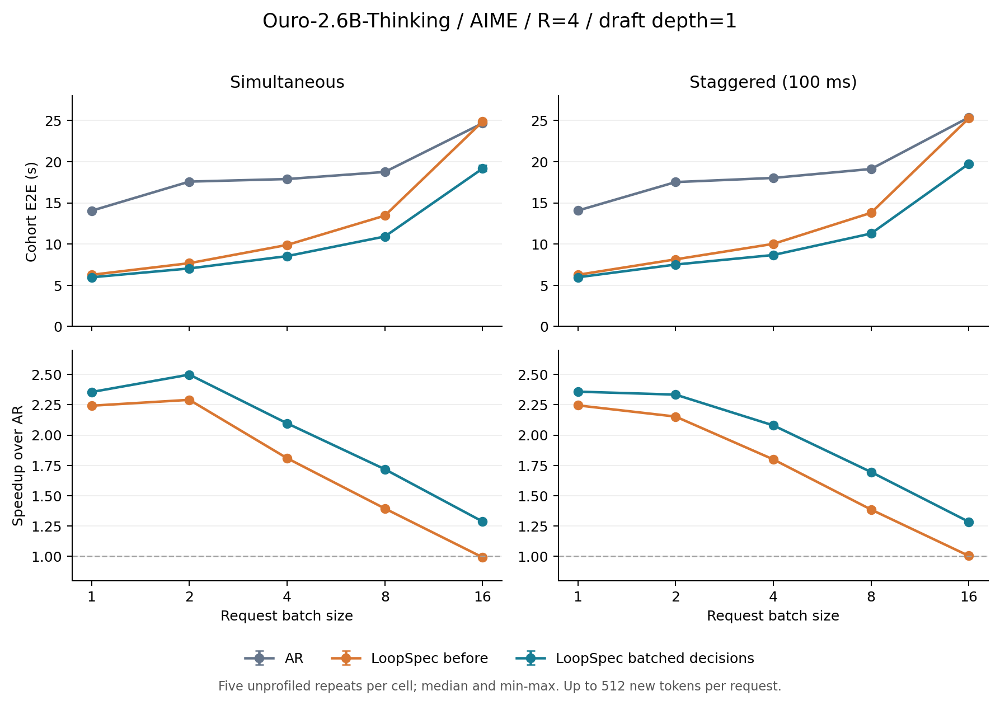
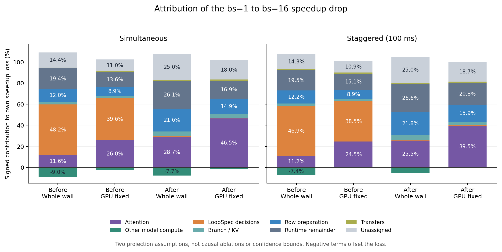

# 批量 endpoint 决策：AR / 旧 LoopSpec / 新 LoopSpec

Ouro-2.6B-Thinking，BF16，R=4，draft depth=1，原生 overlap / LoopSpec V2、core/readout CUDA graph。新决策为批量 eager，未新增决策 CUDA graph。

AIME 前 bs 题，各最多512新token，保留自然EOS；不是完整解题耗时。每格2次预热、5次无Profiler测量；算法块按bs轮换顺序，同GPU串行。交错每题间隔100ms。E2E指整批最早发送到最晚token。

|发送|bs|AR s|旧 LS s|新 LS s|旧加速比|新加速比|新比旧缩时|
|---|---:|---:|---:|---:|---:|---:|---:|
|simultaneous|1|14.045|6.266|5.966|2.242×|2.354×|4.8%|
|simultaneous|2|17.584|7.678|7.039|2.290×|2.498×|8.3%|
|simultaneous|4|17.896|9.893|8.537|1.809×|2.096×|13.7%|
|simultaneous|8|18.760|13.453|10.919|1.394×|1.718×|18.8%|
|simultaneous|16|24.679|24.871|19.172|0.992×|1.287×|22.9%|
|staggered|1|14.066|6.267|5.966|2.244×|2.357×|4.8%|
|staggered|2|17.526|8.144|7.512|2.152×|2.333×|7.8%|
|staggered|4|18.033|10.023|8.672|1.799×|2.079×|13.5%|
|staggered|8|19.119|13.795|11.279|1.386×|1.695×|18.2%|
|staggered|16|25.381|25.269|19.752|1.004×|1.285×|21.8%|

全部单请求E2E/P95、TTFT、decode、输出量、发送偏差与重复范围见 performance.csv / requests.csv。

## 正确性和比较边界

- ar/old 完整token序列及停止原因一致：42/310；首差异见 token-comparison.csv。
- ar/new 完整token序列及停止原因一致：50/310；首差异见 token-comparison.csv。
- old/new 完整token序列及停止原因一致：110/310；首差异见 token-comparison.csv。

28项CPU/CUDA决策测试、38项HTTP生命周期检查及严格内存smoke通过。固定logits的greedy决策严格等价；同前缀hidden/logits幅度在原独立native校准范围内，但bs1/2/4仍未通过原1% argmax翻转率门槛，冻结旧版与新版的逐位置记录完全相同；bs8/16通过。未改阈值，不能把这些证据表述为所有数值标准通过。

自由生成不一致不能被当成无损通过，也不能仅凭一次序列差异确定是这次决策合批出错。固定logits决策、模型同前缀计算、不同到达/合批形状与完整生成必须分别分析。本次证据支持所测逻辑等价及未见新增数值回归，不支持严格token无损或完整AIME答题正确率结论。详细证据见[validation.md](validation.md)、[numerical-summary.json](numerical-summary.json)和[任务记录](../record.md)。

## 每输出token的精细Profile

depth0尚需4轮、depth3已有3轮状态可复用。下表是该token路径经历的共享阶段中位数CPU/GPU stream ms；各阶段嵌套且CPU/GPU重叠，不能相加为E2E，也不能跨请求累计为独占成本。GPU stream包括等待。首token的prefill见profile-summary.json，原始共享step IDs仍在X5 output-paths.json。

|发送|bs|入口depth|输出数|准备CPU/GPU|core CPU/GPU|readout CPU/GPU|decision CPU/GPU|commit CPU/GPU|retain CPU/GPU|回读CPU|
|---|---:|---:|---:|---:|---:|---:|---:|---:|---:|---:|
|simultaneous|1|0|42|2.289/2.243|5.457/37.577|0.744/1.038|1.177/0.886|0.055/0.044|0.041/0.033|0.140|
|simultaneous|1|3|469|0.693/0.684|0.947/9.530|0.181/0.257|0.290/0.217|0.054/0.043|0.041/0.033|0.035|
|simultaneous|2|0|103|3.213/3.147|5.698/41.226|0.750/1.046|1.163/0.892|0.273/0.220|0.206/0.168|0.142|
|simultaneous|2|3|919|0.866/0.857|1.082/10.078|0.183/0.259|0.288/0.220|0.111/0.090|0.084/0.067|0.035|
|simultaneous|4|0|189|4.827/4.758|5.342/42.575|0.751/1.049|1.156/0.911|0.602/0.486|0.515/0.428|0.146|
|simultaneous|4|3|1855|1.277/1.269|1.073/10.635|0.183/0.259|0.284/0.222|0.209/0.171|0.161/0.130|0.036|
|simultaneous|8|0|414|8.153/8.112|5.904/41.800|0.728/1.015|1.141/0.980|1.312/1.046|1.119/0.931|0.146|
|simultaneous|8|3|3674|2.080/2.070|1.242/10.541|0.183/0.260|0.282/0.245|0.382/0.310|0.318/0.265|0.036|
|simultaneous|16|0|947|15.906/15.867|5.713/68.578|0.720/1.000|1.201/1.125|2.628/2.072|2.516/2.131|0.149|
|simultaneous|16|3|7229|3.991/3.979|1.309/16.995|0.177/0.243|0.296/0.280|0.730/0.564|0.661/0.552|0.036|
|staggered|1|0|42|2.268/2.234|5.374/37.353|0.743/1.042|1.166/0.876|0.055/0.045|0.040/0.031|0.143|
|staggered|1|3|469|0.679/0.670|0.939/9.303|0.184/0.260|0.290/0.217|0.054/0.044|0.040/0.031|0.035|
|staggered|2|0|103|3.247/3.213|5.518/40.403|0.762/1.061|1.170/0.890|0.279/0.225|0.195/0.158|0.142|
|staggered|2|3|919|0.872/0.861|1.102/10.027|0.187/0.262|0.289/0.220|0.113/0.091|0.079/0.062|0.035|
|staggered|4|0|184|4.872/4.828|5.202/42.238|0.763/1.061|1.141/0.894|0.620/0.501|0.489/0.404|0.144|
|staggered|4|3|1860|1.284/1.271|1.166/10.648|0.188/0.263|0.284/0.223|0.183/0.147|0.155/0.127|0.036|
|staggered|8|0|412|8.354/8.199|5.586/42.057|0.736/1.017|1.129/0.969|1.306/1.042|1.123/0.932|0.144|
|staggered|8|3|3676|2.088/2.068|1.271/10.593|0.186/0.264|0.281/0.243|0.364/0.288|0.303/0.249|0.036|
|staggered|16|0|938|15.766/15.583|5.516/68.026|0.743/1.002|1.192/1.123|2.625/2.074|2.370/1.993|0.147|
|staggered|16|3|7238|3.998/3.918|1.336/16.657|0.178/0.244|0.296/0.281|0.719/0.557|0.614/0.509|0.036|

新版本的独立readback span在旧版本属于scatter余项；比较余项时须加回新readback，不应将插桩边界变化当成工作消失。计划/collect、native result handler和客户端ITL见profile-summary.json中的depths；它们是包含GPU等待的主机区间，不能再与上述GPU时间相加。

## 实际分支计算量和readout graph覆盖

LoopSpec并行推进未来token的depth；全接受时主要减少串行关键路径，不按同样倍数减少core行计算量。下表按共享step只计一次。graph覆盖按真实endpoint数、捕获集合和当前无hidden-state请求的精确行数路由核对。

|发送|版本|bs|平均core行数|每提交token的core行推进数|含padding行推进数|readout graph覆盖|
|---|---|---:|---:|---:|---:|---:|
|simultaneous|old|1|3.59|4.481|4.481|100.0%|
|simultaneous|new|1|3.59|4.481|4.481|100.0%|
|staggered|old|1|3.59|4.481|4.481|100.0%|
|staggered|new|1|3.59|4.481|4.481|100.0%|
|simultaneous|old|2|7.09|4.534|4.534|100.0%|
|simultaneous|new|2|6.74|4.593|4.593|100.0%|
|staggered|old|2|6.68|4.593|4.593|100.0%|
|staggered|new|2|6.67|4.593|4.593|100.0%|
|simultaneous|old|4|13.37|4.531|4.641|100.0%|
|simultaneous|new|4|13.40|4.543|4.649|100.0%|
|staggered|old|4|13.22|4.528|4.647|100.0%|
|staggered|new|4|13.20|4.528|4.635|100.0%|
|simultaneous|old|8|24.47|4.580|4.814|57.9%|
|simultaneous|new|8|24.24|4.595|4.822|57.0%|
|staggered|old|8|23.65|4.575|4.802|58.2%|
|staggered|new|8|23.74|4.593|4.813|59.4%|
|simultaneous|old|16|47.71|4.669|4.959|35.1%|
|simultaneous|new|16|47.08|4.682|4.975|39.0%|
|staggered|old|16|45.31|4.693|5.007|34.5%|
|staggered|new|16|45.02|4.675|4.976|36.0%|

## 为什么batch增大时加速比下降：实测修复收益

定义 r=L1/A1，E_B=L_B−r·A_B。E_B表示在bs=B保持bs1加速比还需省下的LoopSpec时间。E_B≤0表示加速比没有下降；保留负值表示改善，不定义损失贡献或恢复百分比。旧、新各用自己的r；因此“恢复比例”扣除了bs1也获得的优化，不等于新旧E2E降幅。该干预包含greedy特化、合批和减少无用操作，不能单独归因于某一个算子。

|发送|bs|旧损失s|新损失s|修复消除损失s|消除比例|
|---|---:|---:|---:|---:|---:|
|simultaneous|2|-0.166|-0.429|0.264|无下降|
|simultaneous|4|1.909|0.935|0.974|51.0%|
|simultaneous|8|5.084|2.950|2.134|42.0%|
|simultaneous|16|13.862|8.690|5.172|37.3%|
|staggered|2|0.335|0.078|0.257|76.8%|
|staggered|4|1.988|1.023|0.965|48.5%|
|staggered|8|5.277|3.169|2.108|39.9%|
|staggered|16|13.961|8.986|4.976|35.6%|

上表是额外耗时损失的恢复比例。直接比较加速比跌幅 D_B=S_1−S_B，数值不同：

|发送|bs|旧加速比跌幅|新加速比跌幅|跌幅收窄比例|
|---|---:|---:|---:|---:|
|simultaneous|2|-0.048|-0.144|无下降|
|simultaneous|4|0.433|0.258|40.4%|
|simultaneous|8|0.847|0.636|24.9%|
|simultaneous|16|1.249|1.067|14.6%|
|staggered|2|0.092|0.024|73.5%|
|staggered|4|0.445|0.278|37.5%|
|staggered|8|0.859|0.662|22.9%|
|staggered|16|1.240|1.072|13.5%|

## 各步骤的有符号时间分解估算（不是精确因果比例）

先将Profile时间轴分成互斥区间：GPU执行优先，CPU仅计算未被GPU覆盖的阶段，未知空隙保留未归因。whole_wall以各区间占比统一缩放到无Profiler E2E；gpu_fixed保留实测GPU忙时，仅缩放CPU/空隙到剩余E2E。后者假设Profile kernel时长和工作形状能代表无Profiler，若GPU忙时已超过无Profiler E2E则拒绝估算。两种口径差异是方法敏感性，不是置信区间。

贡献 Δj=(L̂Bj−L̂1j)−r(ÂBj−Â1j)，各项之和为E_B；Δj/(r·L_B)之和等于加速比跌幅，因此同一版本/bs内的贡献百分比也对应其加速比跌幅。负数表示抵消下降，正数可能超过100%。阶段含其CPU提交空隙；运行时余项可包含由外层runtime提交、未细分的GPU算子。不能把占用分区称为精确因果贡献或可全部回收的优化收益。

|发送|版本|bs|投影口径|attention|模型其他计算|decision|分支/KV|prepare|运行时余项|传输|未归因|
|---|---|---:|---|---:|---:|---:|---:|---:|---:|---:|---:|
|simultaneous|old|2|whole_wall|无下降|无下降|无下降|无下降|无下降|无下降|无下降|无下降|
|simultaneous|old|2|gpu_fixed|无下降|无下降|无下降|无下降|无下降|无下降|无下降|无下降|
|simultaneous|old|4|whole_wall|0.7%|-40.5%|71.1%|3.8%|14.8%|22.6%|1.1%|26.3%|
|simultaneous|old|4|gpu_fixed|11.2%|-13.1%|54.6%|2.5%|10.7%|14.2%|1.7%|18.3%|
|simultaneous|old|8|whole_wall|12.7%|-30.1%|59.1%|3.1%|13.1%|21.9%|1.1%|19.1%|
|simultaneous|old|8|gpu_fixed|24.6%|-13.8%|47.6%|2.2%|9.6%|14.2%|1.6%|14.1%|
|simultaneous|old|16|whole_wall|11.6%|-9.0%|48.2%|2.8%|12.0%|19.4%|0.8%|14.4%|
|simultaneous|old|16|gpu_fixed|26.0%|-2.3%|39.6%|2.0%|8.9%|13.6%|1.1%|11.0%|
|simultaneous|new|2|whole_wall|无下降|无下降|无下降|无下降|无下降|无下降|无下降|无下降|
|simultaneous|new|2|gpu_fixed|无下降|无下降|无下降|无下降|无下降|无下降|无下降|无下降|
|simultaneous|new|4|whole_wall|10.8%|-58.0%|1.5%|7.9%|34.7%|41.8%|1.8%|59.6%|
|simultaneous|new|4|gpu_fixed|24.4%|-27.0%|2.2%|5.2%|24.9%|27.4%|2.3%|40.6%|
|simultaneous|new|8|whole_wall|28.6%|-35.8%|1.0%|6.0%|26.6%|34.6%|1.4%|37.5%|
|simultaneous|new|8|gpu_fixed|43.0%|-18.5%|1.3%|4.1%|19.0%|22.5%|1.9%|26.8%|
|simultaneous|new|16|whole_wall|28.7%|-7.7%|0.6%|4.8%|21.6%|26.1%|0.9%|25.0%|
|simultaneous|new|16|gpu_fixed|46.5%|-1.4%|0.6%|3.2%|14.9%|16.9%|1.2%|18.0%|
|staggered|old|2|whole_wall|-27.6%|-151.8%|139.8%|6.9%|38.1%|28.9%|2.5%|63.1%|
|staggered|old|2|gpu_fixed|-3.0%|-92.0%|104.5%|4.5%|27.0%|13.5%|3.4%|42.0%|
|staggered|old|4|whole_wall|1.4%|-35.9%|66.9%|3.4%|15.3%|22.0%|1.1%|25.9%|
|staggered|old|4|gpu_fixed|11.0%|-11.2%|51.9%|2.3%|11.1%|14.9%|1.6%|18.3%|
|staggered|old|8|whole_wall|12.1%|-26.0%|56.3%|2.9%|13.2%|22.0%|1.0%|18.5%|
|staggered|old|8|gpu_fixed|23.2%|-10.4%|45.0%|2.0%|9.6%|15.4%|1.6%|13.6%|
|staggered|old|16|whole_wall|11.2%|-7.4%|46.9%|2.6%|12.2%|19.5%|0.8%|14.3%|
|staggered|old|16|gpu_fixed|24.5%|-0.9%|38.5%|1.8%|8.9%|15.1%|1.1%|10.9%|
|staggered|new|2|whole_wall|-65.5%|-464.7%|13.8%|31.4%|182.7%|97.0%|8.2%|297.2%|
|staggered|new|2|gpu_fixed|8.6%|-333.6%|17.2%|20.2%|130.5%|52.7%|10.2%|194.2%|
|staggered|new|4|whole_wall|11.0%|-46.1%|0.9%|7.2%|33.3%|36.9%|1.7%|55.1%|
|staggered|new|4|gpu_fixed|23.6%|-19.4%|1.7%|4.8%|23.8%|25.6%|2.1%|37.9%|
|staggered|new|8|whole_wall|27.3%|-28.6%|1.0%|5.6%|25.6%|33.1%|1.4%|34.7%|
|staggered|new|8|gpu_fixed|39.8%|-14.3%|1.2%|3.8%|18.5%|23.9%|1.8%|25.2%|
|staggered|new|16|whole_wall|25.5%|-5.0%|0.7%|4.5%|21.8%|26.6%|0.9%|25.0%|
|staggered|new|16|gpu_fixed|39.5%|-0.0%|0.7%|3.2%|15.9%|20.8%|1.2%|18.7%|

bs16新增的题目有648/861 token长输入，而bs8最长182；这不是固定长度的纯batch扩展。attention增长包含请求数、分支行数、上下文长度、接受率和计算形状变化。没有独立attention干预实验，不能将上表称为attention优化必然可回收的收益。

bs2交错的新版本额外耗时损失仅0.078秒，其贡献百分比对测量波动和投影假设十分敏感，不适合按这些大正/负比例给瓶颈排序。未归因区间包含尚未细分的运行时、等待和可能的插桩开销；两种投影都未独立识别每一阶段的Profiler额外成本，不能将方法差异解释为完整误差界。

|发送|bs|AR Profile/实测|旧LS Profile/实测|新LS Profile/实测|
|---|---:|---:|---:|---:|
|simultaneous|1|1.033×|1.261×|1.251×|
|simultaneous|2|1.025×|1.318×|1.318×|
|simultaneous|4|1.022×|1.386×|1.271×|
|simultaneous|8|1.011×|1.459×|1.308×|
|simultaneous|16|1.004×|1.448×|1.302×|
|staggered|1|1.027×|1.253×|1.234×|
|staggered|2|1.023×|1.289×|1.234×|
|staggered|4|1.021×|1.363×|1.259×|
|staggered|8|1.018×|1.446×|1.286×|
|staggered|16|1.027×|1.438×|1.272×|

## 算法路径与结果解读

入口depth不是目标深度或早退阈值。target始终完整R=4：depth3表示已保存该token前三轮的hidden/KV，只需再推进一轮；depth0需要四轮。每轮由普通CDB选择就绪工作，prepare_rows组装临时行及各自的depth/branch KV，core推进一轮。到达draft depth=1或target depth=4的endpoint一起执行readout和决策，整包回读一次；collect只发布完成target验证的token，commit转移已验证KV所有权，retain保留被选中的后继或建立新的depth0根，随后走原生结果处理和客户端流式输出。

同一共享step还会推进其他请求和未来token。因此depth0表里的四次readout/decision不表示当前单个token本身有四个独立验证点；bs16的commit/retain时间也包含同批其他请求。全体95046个decode输出均检查了唯一路径、客户端/结果处理覆盖和`cycles=4-entry_depth`，结果见[path-validation.json](path-validation.json)。首token的四轮prefill另计。

**决策合批修复了原先随endpoint数量增长的开销。** 同时发送时，depth3路径的decision CPU中位数由bs1的0.290 ms到bs16的0.296 ms，基本不变；固定32-endpoint greedy微基准的kernel数1537→18、同步packet时间12.057→0.198 ms。微基准使用固定checkpoint logits及可控候选元数据，不是完整serving的预测倍数。无Profiler实测bs16 E2E缩短22.9%/21.8%（同时/交错）。

**剩余core GPU增量主要与attention增长一致。** 新版同时发送depth3的core GPU stream区间9.530→16.995 ms，而整个cohort的attention GPU互斥忙时0.614→7.149秒，其他模型GPU计算4.223→5.537秒；共享decode step数637→813。GPU忙时覆盖整个cohort、含prefill，不能把它和逐路径中位数直接相减。当前`ouro_attention.py`为保持checkpoint舍入边界分两遍扫描KV，depth/branch的KV不能随共享权重合并；把更多分支合批不会按同样倍数消除attention工作。bs8/16平均prompt长约121/201 token，长上下文也是这次增长的一部分。这里的硬件机制解释来自实现和时间分布，没有独立带宽/占用率计数或attention消融，不能进一步宣称某个微架构因素占精确百分比。

**主机准备和分支管理仍会随合批规模增长。** 新版同时发送depth3的prepare_rows CPU中位数0.693→3.991 ms，commit 0.054→0.730 ms，retain 0.041→0.661 ms；这些是共享批工作，不是每个请求各自独占的成本。原生overlap/V2开启，但分支收集依赖决策回读，不能自动隐藏全部依赖性主机工作。与之相对，readout CPU/GPU中位数0.181/0.257→0.177/0.243 ms，基本平稳；虽然readout graph覆盖从100%降至39%，不能仅凭覆盖下降把它认作主要实测增量。core padding行推进数在bs16约比实际行数多6.3%；当前padding行的seq_lens置1，不复制真实请求的完整上下文，所以不能据此认定attention FLOPs同比增加6.3%。

**接受率变化不是本次新旧改善的主要来源。** 无Profiler计数含2次预热+5次正式运行：bs16同时发送旧/新接受率88.725%/88.755%，共享core步数813.57/813.43；交错88.969%/88.989%，步数861.00/865.86。新版bs1接受率91.781%，至bs16略降；Profile实际每提交token行推进数4.481→4.682，增加约4.5%。与此同时，平均共享core行数3.59→47.08。LoopSpec在小请求batch已经靠多个分支并行摊薄串行循环成本，AR随请求batch增大也获得普通合批收益；这与相对AR优势逐渐收窄的观测一致，不能把全部下降都解释为决策或某个算子实现缺陷。计数见[event-counts.csv](event-counts.csv)，定义为accepted_first/verified_tokens，未混用论文的accepted-length指标。

**阶段百分比的结论：** bs16同时发送，旧版决策约解释39.6%–48.2%的加速比下降，新版降至约0.65%；新版attention约28.7%–46.5%、prepare约14.9%–21.6%、运行时余项约16.9%–26.1%、分支/KV约3.2%–4.8%，仍有约18.0%–25.0%未归因。交错发送旧版决策38.5%–46.9%，新版约0.71%–0.74%，attention约25.5%–39.5%。这些是两种投影结果的范围，各阶段端点不能混搭相加；单独每种口径的有符号贡献才合计100%。其他模型计算为负贡献，表示它抵消了部分相对AR的下降，不能改成0以凑成全正的饼图。

修复的直接实测效果与上述估算分开：同时发送bs16的额外耗时损失13.862→8.690秒，回收37.3%；加速比从bs1到bs16的绝对跌幅收窄14.6%。交错对应35.6%和13.5%。这项干预同时包含greedy特化、批量决策、跳过无用history处理及整批保存logits，不能将其收益再精确拆到其中一个算子。

## 配置、复现与交付

本报告的AR是当前fork普通CDB的full-R路径，LoopSpec是其上的V2 policy；不是未修改的上游或官方LoopSpec独立serving实现。公共启动参数一致，但SGLang既有`cuda_graph_hook.py`对AR和spec模式自动产生不同decode捕获集合：AR=[1,2,4,8,12,16]，spec=[1,2,3,4,5,6,7,8,10,12,14,16]。旧新LoopSpec完整图配置一致，本次未修改该默认逻辑。60个采集单元的SHA、source路径、prompt IDs、公共参数和图配置审计通过，见[capture-validation.json](capture-validation.json)。该文件记录启动内存清单，本次未连续采样serving峰值显存。

生产改动仅在`python/sglang/srt/speculative/loopspec/sampling.py`和`worker.py`，提交`c1c895cc5430cc460bdd958fdbcc852d7a82121a`。旧基线`7df281a0e656e368c90f529d8d84305db99001f5`，完整采集`16ed789a493981b61f63c5d9720564b66b4e8369`，分析工具`208d54b27969106cca0a18f576453883558489b0`，配置审计`bc45401a243d2f4c27aabaa08d10eada4b521ede`。后续实验工具/报告提交没有改动生产实现。

性能、Profile、离线分析和配置审计退出码均为0；30组Profile的时间轴对齐P95误差最大10.97µs。所有10组新旧E2E场景满足≤2%回归门槛，且每组新版最慢观测也快于旧版最快观测。数值未通过项如前述单列。本任务使用8/10轮，停止额外实现迭代；代码与轻量结果只同步`loopspec-test`。

原始数据：`/home/ruoxi/repo/test/results/loopspec/2026-10-30-batched-decisions/`。`round-3/performance/`保留五次计时/预热、逐请求事件、命令和指标；`round-3/profile/`保留Chrome/recurrent trace、共享step及每token路径；`round-3/analysis/`保留自动生成表格；本报告加入了人工解读。执行入口为本任务的`paired_matrix.py`、`report.py`、`validate_captures.py`，精确参数见任务记录和每格manifest。
