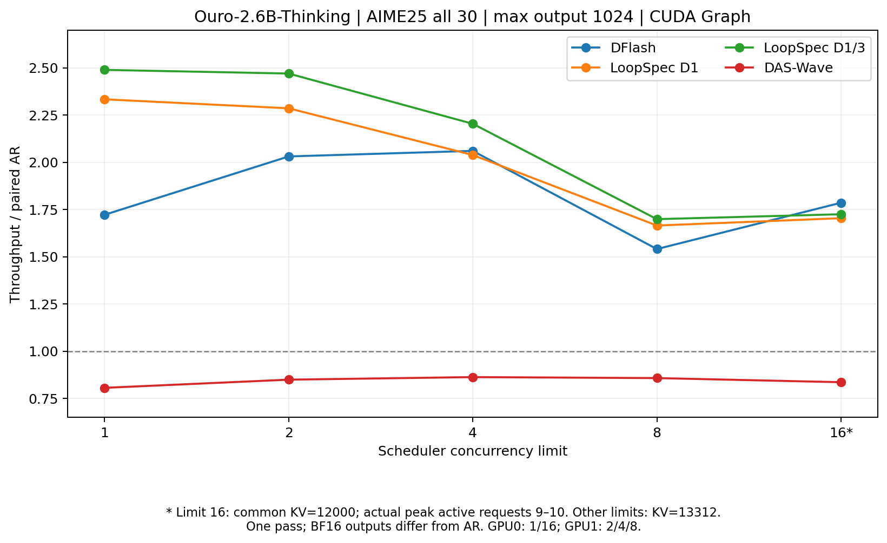

# AIME25 全30题：1024输出上限与 CUDA Graph 实测

实验源码 `da86ebecb1bccfa6aea1e73812e38cefa5c2a05a`，X5 RTX5090 32GB，SGLang v0.5.22 fork。**25组全部完成，750个请求，共768000个输出tokens；每组30题、每题恰好1024 tokens，最终有效组均0 retraction。** 这里“全30题”指完整覆盖题目集合；所有输出都触及长度上限，不是自然完成的解题实验。bs1全部30题均未解析到最终boxed答案，不能将这些吞吐结果当作AIME准确率结论。

严格 AR token 等价仍未通过。表内“加速比”是相同输入、相同输出token上限的实测吞吐比，输出内容可能不同；不是已经证明的无损加速。固定prefix探针支持BF16计算形状造成部分argmax翻转，但没有证明全部分歧均由舍入造成。

## 固定配置与测量口径

- Ouro-2.6B-Thinking，完整 `total_ut_steps=4`，BF16，greedy，原checkpoint Thinking chat template，`enable_thinking=True`、`add_generation_prompt=True`，EOS正常生效。每题 `max_new_tokens=1024`；不另行缩短总上下文，模型原生上限65536。所有方法输入IDs逐项一致。
- 全方法CUDA Graph开启、overlap开启、triton attention、page size1、radix关闭、chunked prefill512、增量SSE、stream interval1。主测试关闭重型trace。DFlash block16；Wave gamma上限16、J4、k1、初始宽度2，**实际四次draft宽度2/3/4/5，最终verify宽度5**。
- bs1逐题串行，以全部请求E2E耗时之和为分母；bs2/4/8/16同时提交30请求，server按 `max-running-requests=B` 调度，以cohort首请求提交至最后响应的makespan为分母。每个配置一次完整pass，无重复测量置信区间。
- 同B的五方法在同一GPU串行；B1/16用GPU0，B2/4/8用GPU1。部分测量期间另一张卡有独立任务，两卡共享CPU，后期另一卡空闲。跨B曲线同时受到GPU、CPU负载、调度变化影响，不能作为纯batch扩展效率。
- B1/2/4/8统一KV容量13312。B16统一KV容量12000，并用 `SGLANG_INIT_NEW_TOKEN_RATIO=1`、`SGLANG_MIN_NEW_TOKEN_RATIO_FACTOR=1` 预留完整输出预算。B16是**并发上限16，实际峰值9–10**，并非固定16条全程生成；KV池容量不代表截断上下文。
- TTFT包括排队、prefill和首个流式事件，不能当纯prefill。B1缺少server prefill元数据，明确记为缺失；其他B的server prefill字段是服务端时间戳间隔，含调度穿插，不是纯GPU计算时间。CSV保留这些字段。

## 吞吐与相对 AR 比值

每格为 tokens/s（相同B的AR吞吐比）。

| 并发上限 | AR | DFlash | LoopSpec D1 | LoopSpec D1/3 | DAS-Wave |
| --- | --- | --- | --- | --- | --- |
| 1 | 30.51 (1.00×) | 52.53 (1.72×) | 71.18 (2.33×) | 75.93 (2.49×) | 24.59 (0.81×) |
| 2 | 54.03 (1.00×) | 109.72 (2.03×) | 123.49 (2.29×) | 133.43 (2.47×) | 45.88 (0.85×) |
| 4 | 96.28 (1.00×) | 198.35 (2.06×) | 196.24 (2.04×) | 212.16 (2.20×) | 83.06 (0.86×) |
| 8 | 176.79 (1.00×) | 272.34 (1.54×) | 294.35 (1.67×) | 300.32 (1.70×) | 151.60 (0.86×) |
| 16 * | 168.97 (1.00×) | 301.71 (1.79×) | 287.89 (1.70×) | 291.44 (1.72×) | 141.21 (0.84×) |

B16各方法实际活跃生成峰值：AR=10，DFlash=9，LoopSpec D1=10，LoopSpec D1/3=10，DAS-Wave=10。活跃区间按客户端first-token到last-token计算，不等于每个CUDA forward的打包行数；CDB逐日志batch分布另存JSON。

## 平均接受率

以下为逐题比率的宏平均，格式 **accepted/tested % / accepted/proposed %**。前者只计真正比较的候选，后者计所有提出的草稿；遇到首个拒绝时未继续比较的后缀仍属于proposed。DFlash server常见accept-rate接近后者。LoopSpec D3是D1失败后实际走到第二候选的条件接受率，不应与D1相加；被剪掉的分支使利用率低于tested接受率。原JSON同时保留总计数与微平均。

| 并发上限 | DFlash | LoopSpec D1 | LoopSpec D1/3：D1 | LoopSpec D1/3：D3 | DAS-Wave |
| --- | --- | --- | --- | --- | --- |
| 1 | 55.67 / 8.62 | 89.11 / 67.77 | 89.75 / 68.98 | 96.77 / 78.19 | 48.18 / 18.64 |
| 2 | 54.97 / 8.39 | 89.32 / 68.33 | 89.20 / 67.70 | 97.31 / 77.54 | 48.18 / 18.64 |
| 4 | 55.35 / 8.51 | 89.55 / 68.81 | 89.48 / 68.19 | 96.52 / 76.56 | 47.90 / 18.44 |
| 8 | 54.81 / 8.31 | 89.27 / 68.23 | 89.00 / 67.18 | 97.18 / 78.29 | 48.06 / 18.57 |
| 16 | 55.29 / 8.47 | 89.13 / 67.87 | 89.14 / 67.57 | 96.92 / 77.56 | 47.86 / 18.42 |

## bs1无Profile计时

| 方法 | 平均TTFT ms | decode ms/输出token | 完整decode ms/验证周期 | 周期定义 |
| --- | --- | --- | --- | --- |
| AR | 57.472 | 32.755 | 32.755 | 一个完整R4输出token |
| DFlash | 61.716 | 18.994 | 42.797 | 一次draft+verify，含调度/传输摊销 |
| LoopSpec D1 | 65.615 | 13.999 | 13.999 | 流水线完成一个target输出；按深度拆分见Profile |
| LoopSpec D1/3 | 65.605 | 13.118 | 13.118 | 流水线完成一个target输出；按深度拆分见Profile |
| DAS-Wave | 125.354 | 40.589 | 78.007 | 一次draft+verify，含调度/传输摊销 |

DFlash累计13621次verify，DAS-Wave15969次；每次周期平均发出约2.25和1.92个decode tokens。LoopSpec D1共40797个core steps，D1/3共37367个，即每个验证输出平均1.329和1.218个新core；每个core均含48个物理层。LoopSpec流水线草拟与验证重叠，不能把一个core step称为独立完整draft+verify周期。

## 完整性、数值分歧与资源失败

| 并发上限 | DFlash分歧题数 | LoopSpec D1 | LoopSpec D1/3 | DAS-Wave |
| --- | --- | --- | --- | --- |
| 1 | 29/30 | 29/30 | 30/30 | 29/30 |
| 2 | 30/30 | 18/30 | 15/30 | 14/30 |
| 4 | 29/30 | 12/30 | 30/30 | 30/30 |
| 8 | 28/30 | 29/30 | 30/30 | 29/30 |
| 16 | 29/30 | 28/30 | 29/30 | 30/30 |

所有最终有效组的输入/输出IDs数量、停止原因、30个题ID和实际服务端algorithm已经校验。正式AIME请求阶段CUDA Graph日志无False；DFlash多batch日志各有一次False，核实为计时前/health的单token探活prefill（input_ids=[0]），发生在get_server_info和正式请求提交之前，另存graph-audit记录；bs1 Wave逐请求累计graph replay差值等于5×周期数，对应4次draft和1次verify。其他方法的capture/replay记录及启动命令保留在raw。旧external-server客户端的占位algorithm字段不代表实际服务端算法，以server_info和actual-launch为准。

保留而未混入主表的失败：默认B16/13312 KV的AR出现多次retraction，客户端报 `Incomplete output IDs for run-0-q17`；开启完整预算预留后AR仍有1次retraction；Wave在13312 KV的B16 graph capture OOM（图私有池约3.55GiB）。最终五方法全部统一12000 KV重新运行，并逐请求检查累计retraction=0，未用最后一次Prometheus gauge=0替代累计计数。LS/Wave计数在retraction后会重置，因此旧压力组不能当完整接受率证据。

## 详细Profile

45个独立bs1窗口已完成，Depth1/3条件区间、prepare/commit/forward、CPU等待与GPU attention/GEMM占比见 [profile-report.md](profile-report.md)。该结果不替代上面的无Profile主计时。

## 数据与复查入口

- [25组CSV](results/aime25-output1024-matrix.csv)、[bs1汇总](results/aime25-output1024-bs1.json)、[bs1周期计时与图核对](results/aime25-output1024-bs1-timing.json)、[bs2/4/8汇总](results/aime25-output1024-bs2-4-8.json)、[bs16统一12000 KV汇总](results/aime25-output1024-bs16-kv12000.json)。
- [CUDA Graph审计](results/aime25-output1024-graph-audit.json)、[源码与启动环境审计](results/aime25-output1024-environment-audit.json)。
- 冻结题面：MathArena/aime_2025 revision `c94da77eb22bbd6439e62a323bec18493a421302`，30题JSONL SHA256 `b1cb6f70eb12b5a0e68f9ea88be9a35c6a3c66f0d00112b5b26160b042326b19`。旧LaTeX损坏数据未用于最终实验。
- X5 raw根目录 `/home/ruoxi/experiments/loopspec/2026-11-05-das-wave/`，主结果分别在 `aime25-output1024-graph-bs1/run`、`aime25-output1024-matrix`、`aime25-output1024-matrix-b16-kv12000`。完整prompt IDs、输出IDs、SSE事件、实际命令、server_info、日志和指标留在X5。
