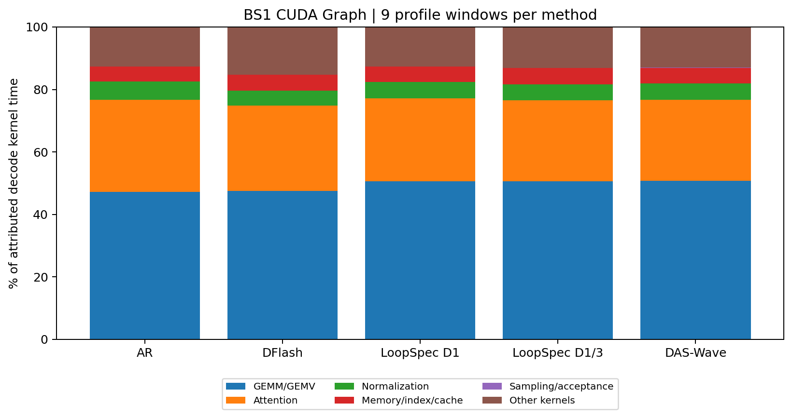

> 历史归档（2026-11-06）：DAS-Wave 已按用户要求撤除；本文描述撤除前的实现和结果，不代表当前可用算法。DFlash/LoopSpec 公共工具与修复保留。见 [撤除记录](../2026-11-06-remove-das-wave/record.md)。

# bs1 详细 Profile：Ouro-2.6B-Thinking / CUDA Graph

45窗口全部完成：AR、DFlash、LoopSpec D1、LoopSpec D1/3、DAS-Wave各9个窗口；题ID0/2/20，原始输入54/137/804 tokens，分别在各自主轨迹0%/50%/90%处重建前缀，再生成32 tokens。有效前缀长度54–1725，使用完整R4/BF16、CUDA Graph和原生V2，生成长度与前缀位置之外的主参数与bs1一致。每个窗口包含独立prefill，因此不是主运行原位置的无扰动延续。**本报告仅bs1；其他batch仅完成无Profile主对比。**

实验源码 `da86ebecb1bccfa6aea1e73812e38cefa5c2a05a`。原始trace保留在X5 `aime25-output1024-profile-bs1`；[全窗口原始汇总](results/profile-summary.json)、[按请求ID和阶段过滤的汇总](results/profile-aggregate-filtered.json)、[阶段CSV](results/profile-decode-stages.csv)、[45窗口完整性核对](results/aime25-output1024-profile-validation.json)。

## 时间定义和过滤

无Profile的完整30题基准：AR **32.755ms/输出token**，DFlash **42.797ms/draft+verify周期**，DAS-Wave **78.007ms/周期**；LoopSpec D1和D1/3分别 **13.999/13.118ms/输出token**。这些包含实际调度与流式交付的摊销；详细数字见[主报告](benchmark-report.md)。下面的条件深度、阶段占比均来自另行采样的Profile，不用Profiler结果覆盖主基准。

- CPU区间是主机执行/提交/等待时间；GPU stream区间来自CUDA events，可能包含stream空隙、依赖和主机等待，不等于kernel busy。CPU与GPU区间不能相加。
- GPU kernel按CUDA correlation关联其launch，再关联最内层诊断span；prefill/decode按祖先元数据区分。嵌套span不相加，attention是forward内部的kernel分类，不是可与forward相加的独立阶段。
- LoopSpec第一个窗口各有7个非本题请求的输出区间（6-token启动探活轨迹）。按rid排除：D1排除24286个kernel，D1/3排除19141个；原trace/原汇总保留。过滤后AR和两种LoopSpec均各279个decode输出区间。第一个窗口的客户端TTFT仍可能包含该探活请求的排队影响，因此不将TTFT直接作为纯prefill时长。
- Wave捕获150次cycle回调，其中4次提前返回且没有draft/verify，单独记录并从周期均值排除，实际146个周期。DFlash有132个decode周期。
- 结束响应、overlap尾部和GPU事件边界不完全等同，阶段stream区间总和可能与客户端TTFT/decode区间不同；不据此声称利用率超过100%。

## LoopSpec按Depth拆分

`entry_depth`表示待验证root已经完成的循环次数。前一个输出接受D1草稿后，下一验证区间通常从entry3开始，只补1个core；接受D3草稿后从entry1开始，补3个core。entry0包含启动和拒绝重启，补4个core。区间跨多个scheduler调用，以下合计同一输出的步骤；不是把并行lane逐条重复收费。

| 配置/区间条件 | 样本数 | 新core次数 | CPU区间均值 ms | GPU stream区间均值 ms |
| --- | --- | --- | --- | --- |
| loopspec1：接受D1后 | 249 | 1 | 12.506 | 12.493 |
| loopspec1：启动/重启 | 30 | 4 | 49.207 | 49.183 |
| loopspec13：接受D1后 | 252 | 1 | 12.499 | 12.486 |
| loopspec13：接受D3后 | 16 | 3 | 35.030 | 34.993 |
| loopspec13：启动/重启 | 11 | 4 | 49.448 | 49.395 |

D1/3的第二候选条件区间只有16个样本，不能把这个均值当作覆盖全AIME轨迹的稳定统计。没有单独采集无Profiler的条件深度计时，因此不把上述数值标为无扰动延迟。

| D1/3条件区间 | prepare rows ms（占比） | core forward ms（占比） | finish ms | decision ms | commit+retain ms | 其余stream间隔 ms |
| --- | --- | --- | --- | --- | --- | --- |
| 接受D1后 | 0.769 (6.2%) | 10.782 (86.4%) | 0.210 | 0.221 | 0.088 | 0.416 |
| 接受D3后 | 1.982 (5.7%) | 30.607 (87.5%) | 0.676 | 0.661 | 0.087 | 0.981 |
| 启动/重启 | 2.607 (5.3%) | 43.361 (87.8%) | 1.004 | 0.960 | 0.088 | 1.375 |

prepare内部的recurrent.prepare已包含在prepare rows中；decision_readback只记录CPU，不能补造GPU事件时间。D1/3核心forward约占这些stream区间的86–88%，prepare约5–6%。主运行D1/3每输出仅1.218次新core，相比AR的4次显著减少工作；D3路径主要避免拒绝后重新跑满4次，而常见D1路径只补1次。

## AR、DFlash与DAS-Wave的周期阶段

以下均为Profile平均GPU stream区间；括号为同一方法周期区间的占比。Wave的prepare嵌套在draft/verify内，另列其测量值但不重复相加。

| 方法与阶段 | 平均 ms | 周期内比例 |
| --- | --- | --- |
| AR：完整R4 core区间 | 34.053 | 99.55% |
| AR：其中execute_core（嵌套） | 34.004 | 99.41% |
| AR：其中prepare（嵌套） | 0.008 | 0.02% |
| AR：finish/readout | 0.153 | 0.45% |
| dflash：完整周期（132个样本） | 45.117 | 100% |
| dflash：prepare block | 0.008 | 0.02% |
| dflash：draft forward | 1.109 | 2.46% |
| dflash：prepare verify | 0.033 | 0.07% |
| dflash：target verify | 43.780 | 97.04% |
| dflash：accept/融合token提交 | 0.016 | 0.04% |
| dflash：commit features | 0.135 | 0.30% |
| dflash：其余stream间隔 | 0.036 | 0.08% |
| das_wave：完整周期（146个样本） | 90.334 | 100% |
| das_wave：四轮draft，含prepare | 46.460 | 51.43% |
| das_wave：R4 verify，含prepare | 43.041 | 47.65% |
| das_wave：decision | 0.373 | 0.41% |
| das_wave：commit | 0.218 | 0.24% |
| das_wave：其余stream间隔 | 0.241 | 0.27% |
| das_wave：5次prepare合计（嵌套，勿另加） | 1.787 | 1.98% |

DFlash使用融合accept/token commit路径，没有独立`commit_tokens` span。表中accept包含该逻辑，不能因标记不存在就声称token提交耗时为0。AR表中R4 core加finish约为本采样的GPU token区间，不包含服务端排队/结果交付；CPU scheduler stream的事件接近0，不能用它给overlap forward计GPU耗时。

DFlash的draft只有5层，GPU draft forward约1.11ms，而完整R4 target verify约43.78ms。Wave四轮draft约46.46ms，完整verify约43.04ms：R4模型上的草拟成本已经接近再运行一次target。主基准78.007ms/周期除以AR的32.755ms/token，需约2.38个输出/周期才能持平，实际仅约1.92；这解释了当前0.81×结果。DFlash约2.25个输出/周期，超过其约1.31个token的持平要求。

## CPU区间与等待

CPU span的独占值为自身区间减直接子区间，用于防止嵌套重复。这里的百分比并非可直接回收的优化预算：同步依赖可能把GPU工作等待记到prepare、decision或wrapper的CPU区间。

| 方法 | CPU完整周期/步骤 ms | prepare独占 % | forward wrapper独占 % | decision/accept独占 % | commit/retain独占 % | 其他 % |
| --- | --- | --- | --- | --- | --- | --- |
| dflash | 6.202 | 6.82% | 79.73% | 2.01% | 6.11% | 5.33% |
| loopspec1 | 12.440 | 6.76% | 88.93% | 2.61% | 0.68% | 1.02% |
| loopspec13 | 12.367 | 6.04% | 89.67% | 2.55% | 0.71% | 1.03% |
| das_wave | 90.345 | 44.88% | 12.76% | 41.85% | 0.26% | 0.26% |

LoopSpec此表的分母是一轮共享core step，完整输出区间在前面的Depth表。Wave的prepare在CPU上约40.55ms/周期，而GPU事件仅约1.78ms；decision在CPU上约37.81ms而GPU事件约0.37ms。这说明CPU span包含大量依赖等待，不能据此认定“metadata算术占了45%的GPU工作”。进一步精确到阻塞算子需要额外CPU/CUDA API关联分析；本次不把残余wrapper时间臆测为某个单一函数。

## GPU kernel时间构成

分母为**已成功归因到本请求decode的kernel duration之和**，不是端到端墙钟，也不是包含prefill的全trace kernel总和。GEMM/GEMV约47–51%，attention约26–30%，二者共同主导；当前结果不支持把所有瓶颈归为attention。

| 方法 | GEMM/GEMV | Attention | Norm | Memory/index/cache | Sampling/accept | Other |
| --- | --- | --- | --- | --- | --- | --- |
| AR | 47.23% | 29.50% | 5.76% | 4.86% | 0.02% | 12.63% |
| DFlash | 47.50% | 27.29% | 4.77% | 5.10% | 0.05% | 15.29% |
| LoopSpec D1 | 50.53% | 26.68% | 5.18% | 4.89% | 0.09% | 12.63% |
| LoopSpec D1/3 | 50.54% | 25.96% | 5.14% | 5.21% | 0.09% | 13.07% |
| DAS-Wave | 50.68% | 25.94% | 5.25% | 5.07% | 0.06% | 13.00% |

| 方法 | 已归因prefill+decode graph launches | 未映射kernel数/候选总数 | 未映射kernel时间占候选全窗口kernel时间 |
| --- | --- | --- | --- |
| AR | 1475 | 40/2039460 | 0.001% |
| DFlash | 4124 | 5971/1041555 | 5.381% |
| LoopSpec D1 | 570 | 296/788291 | 0.666% |
| LoopSpec D1/3 | 480 | 344/746763 | 0.825% |
| DAS-Wave | 810 | 40/2150208 | 0.000% |

未映射项保留为unknown，不强行塞进某个阶段。DFlash未映射kernel时间约5.4%，不能确定这些全部属于decode或prefill，因此上表attention等占比只针对已归因decode子集。其他方法未映射时间更低。kernel分类按名称，`other`包含元素乘加、RoPE等未单列项。

## Prefill与前缀长度

主bs1运行未启用server prefill时间字段，未填写虚假的0；以下为独立Profile的9个前缀平均GPU事件区间，包含chunked prefill所有core阶段及readout，不能替代主实验纯prefill延迟。

| 方法 | Profile平均TTFT ms | Prefill GPU区间合计/窗口 ms |
| --- | --- | --- |
| AR | 181.525 | 177.846 |
| DFlash | 193.730 | 179.794 |
| LoopSpec D1 | 229.073 | 179.993 |
| LoopSpec D1/3 | 225.366 | 179.538 |
| DAS-Wave | 276.040 | 179.318 |

## 由实测支持的后续方向

1. **Wave先减少草拟成本或提高每周期产出。** 当前draft与verify成本接近1:1，且最终宽度只有5。对J/k/宽度做独立开发集搜索，并做carry/no-carry与deep/aligned KV的2×2消融，区分Ouro无input injection带来的提议质量问题和执行开销；这些实验尚未运行，不能预设增大J或宽度会变快。
2. **优先优化共同target forward。** DFlash的约97%周期GPU区间落在verify；各方法GEMM与attention合计占已归因decode kernel时间约75–77%。Ouro attention当前bs1只有16个head程序，decode query在M=16中只有1行有效，且为保持BF16舍入执行两次KV扫描；split-KV/更适合小query的布局是代码层面的优化候选，必须重新验证数值与KV语义，尚无优化后的实测收益。
3. **再降低LoopSpec准备与同步残余。** D1/3的prepare rows约占GPU stream区间5–6%，可以研究持久device metadata、减少逐lane张量构造和主机读回；现有core wrapper残余需要进一步逐算子归因，不能将CPU等待时间当作全可消除的开销。
4. **继续严格正确性，而不是只追吞吐。** 当前长序列AR等价失败仍在，sampling未支持；所有性能结论限定于本实现、BF16、1024输出上限和这一套backend。10/10修改轮次已用尽，本次只完成测量和后处理，没有开启第11轮源码优化。
