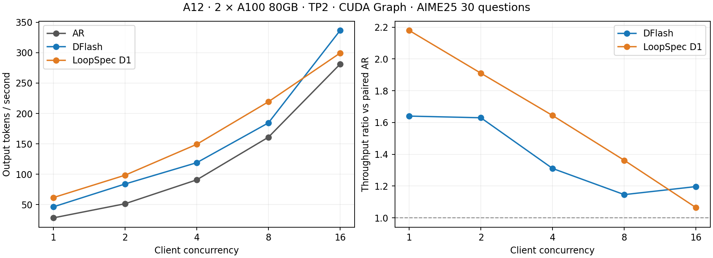

A12 / TP2 的 AR、DFlash、LoopSpec 单 proposal 比较已完成：bs=1/2/4/8/16 × 3算法 × AIME25全30题，共450请求、460,800个输出tokens。每题最多输出1024 tokens；所有请求本次均达到长度上限。这不表示所有题都自然解答结束，也不是AIME准确率评估。

**主结论。** bs1吞吐为AR 28.29、DFlash 46.41、LoopSpec 61.65 tokens/s，对应1.64×和2.18×。并发增大后相对收益下降；bs16分别为1.20×和1.06×，DFlash快于本次单proposal LoopSpec。全部15格无请求重调度，实测区间无CUDA Graph回退日志。

**正确性限制。** 每个batch下，DFlash与LoopSpec均有30/30题的完整输出token序列不同于同batch AR，停止位置均一致。既有BF16形状/归约差异尚未全部定位，本次没有证明所有分歧都来自舍入。因此下述是同输入、同输出预算的实测吞吐比，不能称为已验证的无损、同输出序列加速。

**环境与复现口径。** A12的GPU0/1（A100-SXM4-80GB，NVLink），完整Ouro-2.6B-Thinking R=4，BF16、greedy、原checkpoint Thinking chat template。DFlash block size16（每次15个draft候选），LoopSpec仅depths=[1]；五个batch的两TP rank计数一致，D3 proposed/accepted均0。运行源码`af7eb8ee264ed88ca45752c53d69a35077acd08b`，后处理修正`c035c432c`。正式分支未改。

上下文容量设置65536、KV池40000，不把1024当作上下文上限。TP2、Triton attention、page size1、chunked prefill512、禁用radix cache；CUDA Graph启用。Torch2.14.1+cu130 / Transformers5.19.0 / Triton3.8.0，任务目录CUDA13.0.88工具链及用户态compat；不改系统驱动。A12是共享主机，实验后期GPU2–7有其他任务；GPU0/1用于本任务，不能声称整机独占。各启动manifest保存当时GPU快照。

**吞吐。** 三算法在同一GPU对上串行运行。每组最多bs个并发请求，等待整组完成后清缓存再运行下一组；30不能整除bs时保留尾批。分母为各cohort实际墙钟之和，包含prefill、decode、流式交付与组尾等待，排除启动、warmup及组间flush。只运行一轮，不报告置信区间。

| 客户端并发 | AR tokens/s | DFlash tokens/s | DFlash/AR | LoopSpec tokens/s | LoopSpec/AR |
| ---: | ---: | ---: | ---: | ---: | ---: |
| 1 | 28.29 | 46.41 | 1.64× | 61.65 | 2.18× |
| 2 | 51.54 | 84.01 | 1.63× | 98.46 | 1.91× |
| 4 | 90.82 | 119.05 | 1.31× | 149.30 | 1.64× |
| 8 | 160.98 | 184.54 | 1.15× | 219.28 | 1.36× |
| 16 | 281.18 | 336.55 | 1.20× | 299.39 | 1.06× |



**接受率。** 以下是汇总计数的加权比例。接受/草拟的分母包含未被验证的剩余或被剪枝候选；接受/已测试仅计算实际接受链上测试到的候选。DFlash统计来自verify直方图，包含最后一次长度截断前的原始verify；LoopSpec统计来自完成的target lane决策。AR不适用。逐请求平均接受/已测试另存JSON，bs1为DFlash55.163%、LoopSpec89.290%。

| 并发 | DFlash接受/草拟 | DFlash接受/已测试 | DFlash接受draft/verify | LoopSpec接受/草拟 | LoopSpec接受/已测试 |
| ---: | ---: | ---: | ---: | ---: | ---: |
| 1 | 8.20% | 55.17% | 1.230 | 67.60% | 89.29% |
| 2 | 8.16% | 55.03% | 1.224 | 67.19% | 89.11% |
| 4 | 8.14% | 54.99% | 1.222 | 68.35% | 89.61% |
| 8 | 8.35% | 55.60% | 1.252 | 67.81% | 89.38% |
| 16 | 8.34% | 55.58% | 1.251 | 69.40% | 90.06% |

**每请求延迟。** TTFT包含排队与prefill；decode TPOT为请求decode耗时之和除以其decode token数，不等于多请求吞吐的倒数。DFlash bs≥4的TTFT增加，结合组内完成时间差异说明主吞吐还受入队、调度与组尾等待影响，不能全部解释为GPU verify算子成本。

| 并发 | AR TTFT ms | DFlash TTFT ms | LoopSpec TTFT ms | AR TPOT ms | DFlash TPOT ms | LoopSpec TPOT ms |
| ---: | ---: | ---: | ---: | ---: | ---: | ---: |
| 1 | 58.57 | 64.89 | 68.07 | 35.31 | 21.50 | 16.16 |
| 2 | 109.77 | 125.51 | 125.97 | 38.70 | 21.70 | 19.14 |
| 4 | 181.20 | 1747.71 | 217.37 | 41.47 | 23.18 | 23.59 |
| 8 | 338.22 | 2591.08 | 357.51 | 46.51 | 26.00 | 31.05 |
| 16 | 632.13 | 2202.57 | 680.98 | 52.52 | 32.02 | 45.78 |

**并发证据。** 每格客户端峰值在途请求均等于1/2/4/8/16。客户端在途包含排队，不能冒充GPU固定batch；scheduler日志也可能记录拆分或局部batch视图。以下平均客户端在途数是逐请求elapsed之和/cohort墙钟之和，体现尾部请求完成不同步和尾批，不是GPU利用率。

| 并发上限 | AR平均在途 | DFlash平均在途 | LoopSpec平均在途 |
| ---: | ---: | ---: | ---: |
| 1 | 1.00 | 1.00 | 1.00 |
| 2 | 2.00 | 1.83 | 1.89 |
| 4 | 3.78 | 2.96 | 3.55 |
| 8 | 7.53 | 5.26 | 6.88 |
| 16 | 14.93 | 11.49 | 13.89 |

**无Profiler的bs1时间口径。** AR平均35.313 ms/decode token；DFlash按请求计数摊销47.888 ms/verify周期，接受1.230个draft/verify，另有target输出，原始产出约2.230 tokens/verify。LoopSpec平均16.157 ms/decode token，平均1.324次新core/输出；这是跨步骤摊销，不能把一个共享core step误当作完整draft+verify。prepare/commit/forward/attention与通信细分见[详细Profile](profile-report.md)。

**DFlash修复范围。** 推理draft为`Ouro-2.6B-Thinking-DFlash`，由训练checkpoint导出，58/58 BF16 tensors与来源逐元素一致。兼容修复是Ouro最终第4轮的物理层[1,12,23,34,45]、loop-end norm之前的feature接口，以及prefill CUDA Graph显式输出这些feature；没有重新训练或修改权重。TP2此次补充CDB collective图捕获与LoopSpec跨rank决策同步。

**数据与命令。** [全矩阵JSON](results/matrix-summary.json)、[CSV](results/matrix-summary.csv)、[完整性与rank核对](results/matrix-validation.json)、[逐轮记录](record.md)。原始请求、完整prompt IDs/template、launch、环境manifest和日志在A12 `/homes/ruoxi07/experiments/loopspec/tp2-20261106/matrix/bs{1,2,4,8,16}`；大型原始日志与模型不入Git。

```bash
python research/loopspec/experiments/2026-11-05-das-wave/run_aime25.py \
  --output <new-output> --dataset <aime25-matharena.jsonl> \
  --model <Ouro-2.6B-Thinking> --draft-model <Ouro-2.6B-Thinking-DFlash> \
  --tp-size 2 --batch-size <1|2|4|8|16> --methods ar dflash loopspec1 \
  --tokens 1024 --context 65536 --capacity 40000 --port 30217
```
