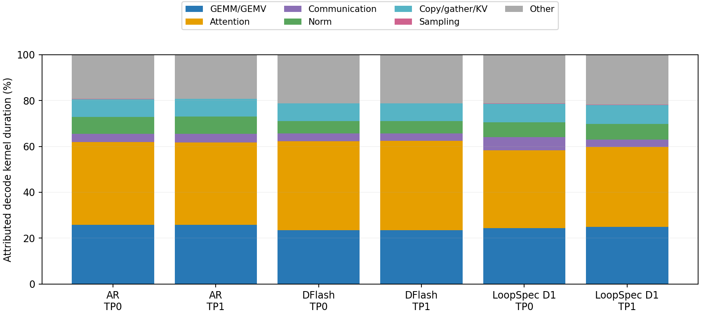

bs1详细Profile已完成：AR、DFlash、LoopSpec单D1 proposal各9窗口，题目0/2/20，分别取各自未Profile生成轨迹的0%/50%/90%前缀，再生成32 tokens。输入/前缀范围54–1725 tokens；每窗口重新prefill，并非主运行中的无扰动暂停。27窗口、54份独立TP rank trace、864个Profile输出tokens全部完整。

**主时间。** 无Profiler全30题基准为AR35.313 ms/decode token、DFlash按请求计数摊销47.888 ms/verify周期、LoopSpec16.157 ms/decode token。LoopSpec按计数摊销约12.203 ms/共享core step，每输出1.324个新core。以下时间来自独立Profile窗口，受采样前缀分布与Profiler本身影响，不能替换主基准耗时或将差值直接当作Profiler开销。

| Profile测量单位 | 样本/每rank | TP0 GPU stream ms | TP1 GPU stream ms |
| --- | ---: | ---: | ---: |
| AR完整R4 token（core合计+readout） | 279 | 39.101 | 39.101 |
| DFlash draft+verify周期 | 127 | 52.166 | 52.157 |
| LoopSpec一个共享core step | 384 | 15.807 | 15.716 |
| LoopSpec完整输出链（跨step合计） | 279 | 21.756 | 21.630 |

DFlash请求元数据报告120次verify，trace实际执行127次draft/verify，其中7个窗口多执行了一轮尚未提交到最终响应的overlap尾部工作；每窗口差值为0或1，target_verify与cycle标记数相等。表中127表示实际执行周期，不表示127次都有有效输出；32-token短窗口放大了这项尾部影响，不能直接外推到1024-token主测试。

CPU区间、GPU stream区间和kernel busy是三种不同口径。GPU stream来自CUDA events，可包含等待与空隙；kernel时间按launch correlation归因。两TP rank分别报告，不能相加当延迟。嵌套阶段也不能相加：attention位于forward内部，recurrent.prepare位于LoopSpec prepare_rows内部。AR的scheduler.forward事件位于调度stream，GPU区间接近0，不能拿它作为AR完整token时间。

**LoopSpec接受与重启路径。** 只有D1 proposal，没有D3 proposal实验。表中entry depth3表示“前一个D1提议被接受后，下一token的root已经计算到第3轮”，因此再补1个core；entry0表示启动/拒绝重启，需要4个core。不能把entry3误读成第二个D3 proposal。

| 路径 | 样本/每rank | 新core数 | TP0 CPU ms | TP0 stream ms | TP1 CPU ms | TP1 stream ms |
| --- | ---: | ---: | ---: | ---: | ---: | ---: |
| 接受D1后续算 | 244 | 1 | 16.035 | 16.008 | 15.939 | 15.911 |
| 启动/拒绝重启 | 35 | 4 | 61.841 | 61.827 | 61.532 | 61.505 |

**周期阶段：GPU stream。** 下表按本方法的测量单位归一化，百分比分母为该单位总stream区间。AR是完整token，DFlash是完整周期，LoopSpec是共享core step。最后一列保留TP1绝对值供对照。

| 方法/阶段 | TP0 ms | TP0占比 | TP1 ms |
| --- | ---: | ---: | ---: |
| AR recurrent.core | 38.9844 | 99.70% | 38.9842 |
| AR recurrent.finish | 0.1163 | 0.30% | 0.1167 |
| AR prepare（嵌套于core，勿另加） | 0.0176 | 0.04% | 0.0174 |
| DFlash prepare block | 0.0158 | 0.03% | 0.0159 |
| DFlash draft forward | 1.1352 | 2.18% | 1.1260 |
| DFlash prepare verify | 0.0445 | 0.09% | 0.0453 |
| DFlash target verify | 50.7393 | 97.27% | 50.7382 |
| DFlash accept/融合token commit | 0.0388 | 0.07% | 0.0403 |
| DFlash commit features | 0.1049 | 0.20% | 0.1046 |
| DFlash其余区间 | 0.0872 | 0.17% | 0.0870 |
| LoopSpec prepare rows | 1.6790 | 10.62% | 1.6754 |
| LoopSpec core forward | 11.9939 | 75.88% | 11.8890 |
| LoopSpec finish/readout | 0.4272 | 2.70% | 0.4334 |
| LoopSpec decision | 0.5037 | 3.19% | 0.5036 |
| LoopSpec TP decision sync | 0.1779 | 1.13% | 0.1876 |
| LoopSpec commit+retain | 0.1363 | 0.86% | 0.1384 |
| LoopSpec其余区间 | 0.8891 | 5.62% | 0.8883 |

DFlash target verify约占97.3%，draft仅约2.2%；优化draft只能影响很小一段时间。accept使用融合token提交，没有独立commit_tokens标记，不能将缺失标记解释为提交耗时0。LoopSpec core forward约75.9%，prepare约10.6%；元数据准备的比重值得关注，但这些stream区间仍包含主机供给与等待。

**LoopSpec按路径的阶段拆分（TP0，每个输出）。** 各行来自同一输出链的全部steps累计，未将并行lane重复计费。

| 路径 | prepare ms | core forward ms | finish ms | decision ms | TP sync ms | commit+retain ms | 其余 ms |
| --- | ---: | ---: | ---: | ---: | ---: | ---: | ---: |
| 接受D1后 | 1.771 | 11.948 | 0.456 | 0.498 | 0.175 | 0.185 | 0.975 |
| 启动/重启 | 6.075 | 48.297 | 1.507 | 2.051 | 0.732 | 0.191 | 2.974 |

**CPU执行/等待。** DFlash cycle CPU为11.519/11.773 ms（TP0/1），result处理区间为39.072/38.700 ms/周期，包含等待，不能当作纯CPU运算。AR forward CPU合计约10.819/10.908 ms/token，去重后的result CPU区间约25.212/25.074 ms/token；CPU/GPU重叠，不能相加。下面给出DFlash周期与LoopSpec core step的CPU互斥分解，残余wrapper也可能等待GPU。

| CPU阶段（TP0） | DFlash ms/周期 | DFlash占比 | LoopSpec ms/step | LoopSpec占比 |
| --- | ---: | ---: | ---: | ---: |
| prepare | 0.824 | 7.15% | 1.763 | 11.14% |
| forward/finish调用 | 8.664 | 75.21% | 2.296 | 14.51% |
| decision/accept与读回 | 0.390 | 3.39% | 0.609 | 3.85% |
| TP决策广播（单列标记） | — | — | 0.198 | 1.25% |
| commit/retain | 0.751 | 6.52% | 0.163 | 1.03% |
| wrapper残余（含潜在等待） | 0.890 | 7.72% | 10.798 | 68.23% |

DFlash没有单独的TP决策广播span，表中的—表示未单列，不能据此说没有通信。LoopSpec core wrapper的CPU独占区间约10.556/10.456 ms/step，而decision_readback本身仅0.077/0.083 ms/调用；等待并不必然记到最后的显式读回。当前证据不能把wrapper残余全部归因为某一行Python代码，亦不能把它视为全部可消除的CPU开销。

**GPU kernel构成。** 分母为同rank成功归因到目标请求decode的kernel duration之和，不是端到端墙钟。按名称分类，generic kernel及部分index/select、逐元素算子归入Other，不能视为精确算子语义覆盖。

| 方法/rank | GEMM/GEMV | Attention | 通信 | Norm | Copy/gather/KV | Sampling | Other |
| --- | ---: | ---: | ---: | ---: | ---: | ---: | ---: |
| ar/TP0 | 25.85% | 36.07% | 3.56% | 7.38% | 7.80% | 0.05% | 19.28% |
| ar/TP1 | 25.73% | 36.07% | 3.69% | 7.46% | 7.76% | 0.05% | 19.23% |
| dflash/TP0 | 23.40% | 38.93% | 3.34% | 5.37% | 7.77% | 0.05% | 21.14% |
| dflash/TP1 | 23.41% | 39.12% | 3.12% | 5.40% | 7.76% | 0.05% | 21.15% |
| loopspec1/TP0 | 24.35% | 33.90% | 5.74% | 6.54% | 8.11% | 0.18% | 21.18% |
| loopspec1/TP1 | 24.89% | 34.87% | 3.26% | 6.76% | 8.33% | 0.19% | 21.70% |



可识别的attention约33.9–39.1%，GEMM/GEMV约23.4–25.9%，两者共同占主要部分；通信约3.1–5.7%，本采样不支持将全部瓶颈归因于TP2通信。Other主要包含逐元素乘加、SiLU与部分index/select，不能视为零成本。

**归因覆盖与图执行。** 有意排除项为通过span识别出的prefill或其他请求；未映射项无法确定阶段，单独保留。DFlash未映射时间约占全窗口kernel时间6.27%，因此其分类表只代表已归因decode子集。Graph launches覆盖整个窗口（含prefill），不是只统计decode。

| 方法/rank | 已归因decode kernel ms | kernel busy union ms | 有意排除 ms | 未映射 ms | 未映射/全窗口kernel | Graph launches |
| --- | ---: | ---: | ---: | ---: | ---: | ---: |
| ar/TP0 | 10741.33 | 10740.46 | 1702.45 | 4.08 | 0.033% | 1475 |
| ar/TP1 | 10746.06 | 10745.27 | 1699.55 | 4.03 | 0.032% | 1475 |
| dflash/TP0 | 6487.17 | 6485.67 | 1219.90 | 515.52 | 6.270% | 4114 |
| dflash/TP1 | 6471.36 | 6469.49 | 1194.81 | 512.74 | 6.269% | 4114 |
| loopspec1/TP0 | 4021.30 | 4020.73 | 1693.45 | 11.55 | 0.202% | 593 |
| loopspec1/TP1 | 3945.97 | 3945.28 | 1687.88 | 17.38 | 0.308% | 593 |

**解释主实验。** DFlash无Profiler按请求计数摊销周期约47.888 ms，AR约35.313 ms/token，持平需要约1.356个输出/周期；实测原始产出约2.230，支持约1.64×吞吐比。LoopSpec靠减少新core次数获得bs1收益，但每step同时处理多条lane，不能按“1.324/4”直接推算理想加速。大batch下，额外lane工作、准备开销、调度及组尾等待都会影响收益；本次只对bs1做详细Profile，不把它的阶段比例外推为bs16的已测结论。

后续若继续优化，优先检查共同target forward的attention、GEMM及逐元素算子，以及LoopSpec的持久metadata/索引准备。DFlash draft只占很小的周期份额，单纯加速draft的收益有限。以上是测量支持的方向，本次没有修改这些kernel；严格AR token等价仍未通过。

**证据与复现。** [主基准](benchmark-report.md)、[聚合JSON](results/profile-aggregate.json)、[阶段CSV](results/profile-stages.csv)、[27窗口验证](results/profile-validation.json)、[压缩逐窗口汇总](results/profile-windows.json.gz)、[逐轮记录](record.md)。原始447MiB traces留在A12 `/homes/ruoxi07/experiments/loopspec/tp2-20261106/profile-bs1`，运行SHA为af7eb8ee2，归因分析SHA为bbba3b764。

```bash
# 在主基准同环境/参数上额外指定：
--batch-size 1 --profile-reference <matrix/bs1> \
  --profile-ids 0 2 20 --profile-tokens 32
python research/loopspec/experiments/2026-11-06-tp2-profile/analyze_tp2.py <profile-bs1>
```
