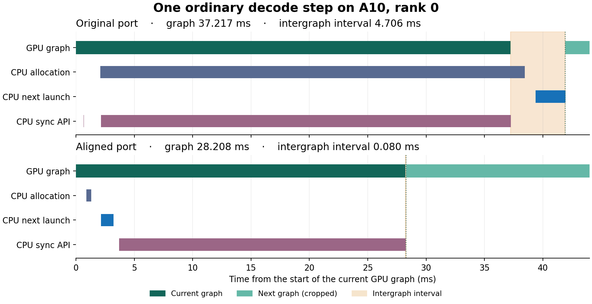

# TP2 单步与图提交

Ouro-2.6B-Thinking，48 个物理层、4 个循环，TP2/DP1。固定 2,048 输入、1,024 新 token、bs4、自训 0.5-bit 码本、HP 8+64。原生 PyTorch profiler 在生成第 928 个 token 附近触发，采集 10 步，得到每个 rank 的 9 个完整相邻图周期。Nsight 的图级采样另起服务运行，取得 CPU launch、同步和 allocator 的 NVTX 范围。下文的吞吐取独立的无 profiler 三次中位数。两个 TP rank 同时工作，分别统计。

## 从用户可见吞吐到算子

| 同一 A10 卡对，bs4 | tok/s | 等效 ms/batch step |
|---|---:|---:|
| 修改前移植 VQ | 103.597 | 38.611 |
| 加 fused RoPE | 131.269 | 30.472 |
| 再加 fused SiLU × up | 135.188 | 29.588 |
| 再批量分配 recent slots | 141.254 | 28.318 |
| 再后移 KV 等待 | 141.402 | 28.288 |
| 同期官方 VQ | 132.577 | 30.171 |
| 同期移植 BF16 | 164.588 | 24.303 |

RoPE 贡献了连续消融中最大的差额，约 8.14 ms/batch step。MLP 再省 0.88 ms，批量分配再省 1.27 ms。延后 KV 等待的独立差额只有 0.03 ms。采样里看到的长 CPU 等待有一部分与前一图 GPU 计算重叠，不应把整段等待加进可回收耗时。三次原始值及 SHA 已保存。[消融数据](ablation.csv)

### 哪项改动消除了 CPU 阻塞

四个候选另外在 A10 0/1 各做一组完全同卡对的原生和图级采样。以下是 rank 0 普通步中位数。提前量以「前图 GPU 结束减下一 launch API 返回」计算，负数表示 CPU 到前图结束后才提交完。

| 累积改动 | 每步 HP 分配 | 每步 8 B H2D | 下一 launch 返回提前量 | Nsight 图间隔 | 原生 profiler 图间隔 |
|---|---:|---:|---:|---:|---:|
| RoPE | 4 | 4 | −3.191 ms | 3.183 ms | 5.100 ms |
| 加 MLP | 4 | 4 | −3.127 ms | 3.118 ms | 5.227 ms |
| 加批量分配 | 1 | 0 | +25.108 ms | 0.109 ms | 0.115 ms |
| 加后移等待 | 1 | 0 | +25.077 ms | 0.081 ms | 0.083 ms |

保持旧等待位置、只更改分配后，rank 0 的普通步由 0/12 提前提交变为 12/12，rank 1 由 0/11 变为 11/11（各采样的有效区间数略有差异）。性能恢复的直接转折点是复用设备请求索引、消除每请求同步的 H2D。单独后移等待主要缩短了最后几十微秒的图间工作。[双 rank 同卡对消融](ablation-profile.csv)

## 一次完整 forward 和相邻图

A10 6/7 原生采样，按有无两个实际编码 kernel 分为 flush 和普通步。下表各列是各分类内中位数，单位 ms。图内活跃和图间活跃分别取 GPU 时间区间并集。「图间余量」是该 rank 上已记录 kernel、拷贝和 memset 未覆盖的时段。每个 rank 有 8 个普通步和 1 个 flush 步，flush 的单个观测不足以估计分位数。

| rank／类型 | 图内跨度 | 图内活跃 | 图间隔 | 图间活跃 | 图间余量 | 两次编码 | 完整周期 |
|---|---:|---:|---:|---:|---:|---:|---:|
| 0 普通 | 28.774 | 28.564 | 0.083 | 0.059 | 0.024 | 0 | 28.855 |
| 1 普通 | 28.773 | 28.555 | 0.083 | 0.058 | 0.025 | 0 | 28.856 |
| 0 flush | 28.781 | 28.571 | 0.473 | 0.436 | 0.038 | 0.361 | 29.254 |
| 1 flush | 28.777 | 28.557 | 0.475 | 0.435 | 0.040 | 0.359 | 29.252 |

同卡对历史普通步中，官方 VQ 的图内跨度为 30.423 ms、图间隔 0.453 ms，修改前移植分别为 38.673 ms、5.672 ms。官方普通步仍提交短编码 kernel，本移植的普通步跳过编码。已有成对记录保留了两个原始栈的逐步分类。[历史普通步与 flush 证据](../official-step/report.md) · [各候选逐步时间](step-periods.csv)

### 四次循环的 attention

A10 6/7、rank 0、flush 后第一普通步。表中为该循环 48 层 kernel 累计时间，单位 ms；循环外的 logits 等计算另计。

| 循环 | 量化区 attention | HP attention | 两区归并 | fused RoPE | 融合激活 | 本循环所有 kernel |
|---:|---:|---:|---:|---:|---:|---:|
| 1 | 2.475 | 0.370 | 0.160 | 0.106 | 0.094 | 7.138 |
| 2 | 2.471 | 0.369 | 0.159 | 0.105 | 0.094 | 7.112 |
| 3 | 2.470 | 0.371 | 0.159 | 0.106 | 0.095 | 7.113 |
| 4 | 2.470 | 0.368 | 0.159 | 0.106 | 0.093 | 7.110 |

两个 rank 的每张稳态图都出现 192 次 fused RoPE 和 192 次融合激活。量化区 attention 占每个循环约 2.47 ms。QKV/O、gate/up、down 投影、RMSNorm、残差、TP collective 和 KV 写入均已逐类统计。[每个循环](step-loops.csv) · [每步的完整分类和调用数](step-kernels.csv)

### 为什么短输出下 BF16 仍快

A10 0/1 上用相同客户端、采样点和 profiler 配对重跑最终 BF16 和最终 VQ。rank 0 普通步周期中位数为 BF16 25.461 ms、VQ 28.891 ms。BF16 的 attention stage 1 加归并为 9.309 ms；VQ 的量化区、HP 区、归并和 LSE 重置总共 12.241 ms。这个 2.933 ms 的差额占 3.430 ms 周期差额约 86%。单是 VQ 量化区 attention 就需要 9.851 ms。两条路径的图间隔分别为 0.081 和 0.083 ms。这里说明约 3K 可见历史、bs4 的瓶颈，其他形状用各自的实际吞吐判断。[两个 rank 的 BF16/VQ 算子对照](bf16-vq-step.csv)

## 输出逐渐变长时，哪一步变快

在 A10 0/1 上独立运行 bs4 的完整 2K→8K 请求。两臂都在整批共同生成 928、1,952、4,000、8,096 个 token 时请求开始各 10 步采样。实际采样在服务端收到触发请求之后。两次请求各有 8,191 条 decode 日志，目标 batch 比例均为 1。以下为 rank 0 普通步中位数，单位 ms。

| 临近新增输出 | 触发时约可见历史 | BF16 完整周期 | VQ 完整周期 | BF16 attention 含归并 | VQ attention 含重置、归并 | 其中量化区 | 其中 HP 区 |
|---:|---:|---:|---:|---:|---:|---:|---:|
| 1K | 2,976 | 25.439 | 28.913 | 9.292 | 12.243 | 9.852 | 1.472 |
| 2K | 4,000 | 27.766 | 30.124 | 11.617 | 13.457 | 11.065 | 1.471 |
| 4K | 6,048 | 32.449 | 33.195 | 16.278 | 16.496 | 14.084 | 1.482 |
| 8K | 10,144 | 41.735 | 39.791 | 25.505 | 23.106 | 20.603 | 1.517 |

历史从约 3K 增长到约 10K 时，BF16 attention 增加 16.21 ms，VQ 增加 10.86 ms。固定大小的 HP 区始终约 1.5 ms，VQ 的增长主要来自量化历史区。4K 输出附近两种 attention 已接近，8K 输出附近 VQ 的完整周期短了 1.94 ms。独立的无 profiler bs4、8K 请求也呈现这个转折：首个 1K 输出段 VQ／BF16 为 0.858×，生成第 5,121–6,144 个 token 的段为 1.012×，最后 1K 段为 1.058×。整段 8K 的倍率为 0.982×，早段和晚段都会影响整段结果。[四个位置的双 rank 汇总](window-profile.csv) · [完整算子](window-kernels.csv) · [各循环细分](window-loops.csv) · [无 profiler 分段吞吐](decode-8192-by-position.csv)

## CPU 在什么位置等待

A10 4/5、rank 0 普通步。GPU 图从 0 执行到 28.208 ms。CPU 在 0.881–1.299 ms 准备 decode 分配，HP 分配一次，在 1.181–1.219 ms 建立 stream 事件依赖。下一次 cudaGraphLaunch 在 2.152 ms 进入、3.204 ms 返回。结果处理在 3.699–28.258 ms 等待 GPU 事件。此时下一图已经提交。下一张 GPU 图在 28.288 ms 开始，图间隔 0.080 ms。原实现同卡对的一个普通步在 2.133–37.252 ms 遇到 H2D 后的 stream 同步，下一次 launch 到 39.365 ms 才进入。

新图级采样中，rank 0 的 15 个间隔和 rank 1 的 14 个间隔全都在前一图结束前完成下次 launch，至少提前 23.63 ms。两 rank 的 runtime 都能看到结果回收的同步。没有观测到原实现的 8 字节 CPU→GPU 请求索引拷贝。普通步的选批通常只需一次批量 recent 分配；flush 的读映射和地址准备在前，写 K/V、发布映射在 stream 事件之后。abort、回收和重新分配仍受相应等待保护。[逐步 launch 和分配](scheduler-steps.csv) · [普通及 flush 的逐事件时间线](ordinary-flush-timeline.csv)

## 数值验证

两栈各在真实 TP2 eager 服务上采集 2K prompt 后第一个 decode 步。逐 rank 保存第一个物理层、第一次循环的原始 QKV，attention 实际收到的 Q/K/V，融合激活的输入输出，以及第 4 次循环后全部 49,152 个 logits。VQ 的 attention K/V 与同一栈的原始 K/V 逐位相同；BF16 的 K 已旋转，V 仍逐位相同。把同一套捕获的张量和 cos/sin 缓存输入官方及移植 kernel，两 rank 的旋转 Q/K、V 和激活输出全都逐位相同。[rank 0 相同输入](fixed-input-rank-0.json) · [rank 1 相同输入](fixed-input-rank-1.json)

完整服务栈在 fused RoPE 之前的 QKV 已出现数值差异。VQ 的两栈最终 logits 最大绝对差 0.16406、平均 0.02983，top-1 相同、top-20 交集 19。BF16 的最大绝对差 0.18750、平均 0.03333，top-1 相同、top-20 交集 20。固定 2K prompt 的 16 个 greedy 输出、混合长度样本的 3×24 个输出和 abort 后复用的 16 个输出在官方 VQ 与移植 VQ 间相同。候选 22 与 24 的这些输出及所选 token 的 logprob 均完全一致。移植 eager 与 graph 在混合长度样本的所选 token logprob 最大差 0.43515，greedy 结果一致。本轮检验的是算子和服务语义，准确率 benchmark 依用户要求暂停。[真实服务张量对照](comparison.json)

## 官方与移植的路径边界

| 路径 | 官方 LoopVQ | 本次移植 |
|---|---|---|
| VQ decode RoPE | 对 Q 和按形状复用的临时 K 就地旋转，attention 接收原始 K/V | 优化 decode 采用同样的数据流。每个 rotary 模块按设备、dtype、形状缓存临时 K，图回放复用地址。 |
| BF16 decode RoPE | 融合算子旋转实际 Q/K，缓存旋转后的 K | 优化 decode 对真实 Q/K 使用现有 SGLang 融合算子。 |
| MLP | gate/up 合并投影，再做 SiluAndMul 和 down projection | 优化 decode 复用本版本 SiluAndMul。gate/up、down 的 TP 切分和 collective 沿用移植栈。 |
| Prefill 与参考算术 | 官方 Ouro 的 RoPE 与激活在 prefill 也走其融合实现 | 修改聚焦优化 decode，prefill 与 hf_reference 仍保留原有 BF16 舍入；移植 RMSNorm 有显式 cast 配置。 |
| 选批与 recent 分配 | 批量请求索引，统一池在 GPU 上准备 flush plan | 复用 batch 自带的设备端索引。全 recent 的 batch 一次分配；混合长度按原请求顺序合并 prefix 和 recent 位置；容量检查先于游标修改。 |
| 旧 history 写入与回收 | 先计划，再通过 forward_done 约束 apply，结果回收可在下一次提交后等待 | 使用 SGLang 现有的调度与 forward stream。上一轮 event 在 KV 编码和发布映射前建立 GPU 顺序，独立的通用 shared-read barrier、回收与 abort 保护仍生效。 |
| 普通步／flush | 统一池的普通步仍可发射很短的编码 kernel | 每请求的 recent 计数由调度器维护，只对达到阈值的行编码。两种编码完成后才发布映射。 |

真实轨迹和消融分别验证了融合调用数、下一图提交时机和最终吞吐。对于上表中仍不同的实现，核对的是实际缓存语义、数值和时间线。

新增两种融合在 hf_reference 上的回归也通过。修改前后各运行一次 BF16 和 VQ 的 TP2 eager 服务，各臂四个样本共 64 个输出 token；逐 token 的 ID、所选 logprob 和停止原因完全相同。[HF 参考路径回归](hf-reference.json)
