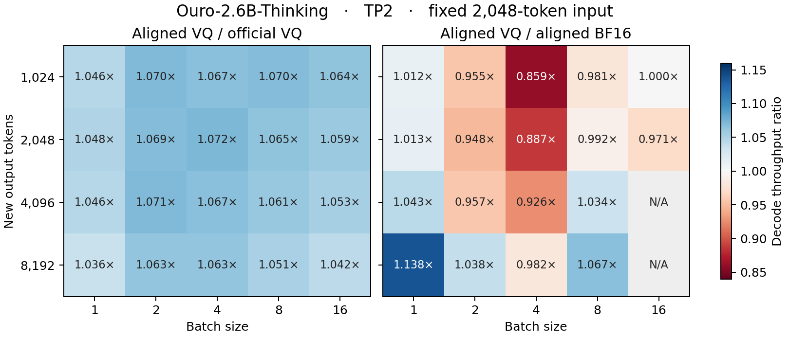

# LoopVQ 移植对齐后的 TP2 纯 decode 实测

主点（bs4、2K 输入、1K 输出）自训 0.5-bit VQ 达到 **141.40 tok/s**，修改前为 **103.60 tok/s**，同卡对官方 VQ 为 **132.58 tok/s**，同卡对优化 BF16 为 **164.59 tok/s**。最终 VQ 分别是原移植、官方和 BF16 的 **1.365×、1.067×、0.859×**。

## 20 个负载的三臂结果

单位为整批 tokens/s，表内为三次无 profiler 测量的中位数。每行固定同机、同一对 A100-SXM4-80GB、相同 prompt IDs 和生成长度。官方列使用作者的服务代码和我们训练的同一套 K/V 码本，BF16 列使用带同样 RoPE/MLP 优化的移植服务。倍率均由未舍入数据计算。

| 新输出 | bs | 主机 | 官方 VQ | 移植 VQ | 移植 BF16 | 移植／官方 VQ | 移植 VQ／BF16 |
|---:|---:|---|---:|---:|---:|---:|---:|
| 1024 | 1 | A12 | 45.05 | 47.12 | 46.54 | 1.046 | 1.012 |
| 1024 | 2 | A12 | 78.88 | 84.44 | 88.39 | 1.070 | 0.955 |
| 1024 | 4 | A10 | 132.58 | 141.40 | 164.59 | 1.067 | 0.859 |
| 1024 | 8 | A12 | 228.70 | 244.65 | 249.40 | 1.070 | 0.981 |
| 1024 | 16 | A13 | 359.68 | 382.72 | 382.59 | 1.064 | 1.000 |
| 2048 | 1 | A12 | 43.46 | 45.55 | 44.95 | 1.048 | 1.013 |
| 2048 | 2 | A12 | 75.07 | 80.25 | 84.70 | 1.069 | 0.948 |
| 2048 | 4 | A13 | 131.03 | 140.46 | 158.44 | 1.072 | 0.887 |
| 2048 | 8 | A13 | 217.14 | 231.24 | 233.12 | 1.065 | 0.992 |
| 2048 | 16 | A13 | 321.65 | 340.72 | 351.02 | 1.059 | 0.971 |
| 4096 | 1 | A13 | 41.59 | 43.51 | 41.74 | 1.046 | 1.043 |
| 4096 | 2 | A13 | 70.40 | 75.41 | 78.82 | 1.071 | 0.957 |
| 4096 | 4 | A13 | 125.59 | 134.00 | 144.68 | 1.067 | 0.926 |
| 4096 | 8 | A12 | 198.99 | 211.18 | 204.24 | 1.061 | 1.034 |
| 4096 | 16 | A12 | 284.64 | 299.85 | N/A | 1.053 | N/A |
| 8192 | 1 | A12 | 39.92 | 41.37 | 36.35 | 1.036 | 1.138 |
| 8192 | 2 | A12 | 66.92 | 71.16 | 68.56 | 1.063 | 1.038 |
| 8192 | 4 | A10 | 113.88 | 121.06 | 123.25 | 1.063 | 0.982 |
| 8192 | 8 | A10 | 165.82 | 174.35 | 163.42 | 1.051 | 1.067 |
| 8192 | 16 | A10 | 216.67 | 225.73 | N/A | 1.042 | N/A |

移植／官方 VQ 在这 20 个负载中为 **1.036–1.072×**。可运行的 18 个 BF16 配对中，VQ／BF16 范围为 **0.859–1.138×**。bs16 的 4K 和 8K 需要分别容纳 98,304 和 163,840 个 token，两次 BF16 服务启动时均实测池上限为 92,432 个 token。它们的 BF16 速度和倍率记为 N/A。每个容量上限、每臂 SHA、设备 UUID、三次原始值都随表保留。

[可下载吞吐表](throughput.csv) · [三次原始值、身份和容量](throughput-repeats.json) · [8K 输出按每 1024 个 token 分段](decode-8192-by-position.csv)



## 测量口径

模型为 Ouro-2.6B-Thinking，R4，TP2/DP1，BF16 模型权重，VQ 为 0.5-bit、无 TaSQ，HP 窗口 8+64。原生 Thinking 模板构造的 2,048 个固定输入 token 在各臂相同。greedy、ignore EOS、增量流间隔 1、full decode CUDA graph、prefill graph 关闭。移植 VQ 与 BF16 的 Triton KV split 分别固定为 48 和 8，均启用相同的 RoPE 与 MLP 优化。每格先两次 32-token 预热，随后三次正式输出。174 次正式测量都从整批共同第 2 个输出 token 计时至最后一个，分子为 bs × (输出长度 − 2)。实际 batch 达到目标的日志比例最小为 1.000000，运行代码另检查 graph=true 和是否发生 retract。输入、首 token 等待和所有 profiler 运行均排除在主吞吐外。

硬件使用 A10、A12、A13 的空闲卡对。A11 的同一个既有进程占用了八张卡，A13 的 0/1 对也有其他进程。主点、消融和数值审计固定在 A10，工作树各自冻结。所有长作业在 tmux 内运行。启动时校验两卡独占及 rank PID。运行中额外取得 253 个卡对进程快照，覆盖 19 个服务时段，采到的卡对上均只有预期进程。官方和移植各使用其适配的依赖环境。每个相对性能都来自同卡对。

作者最终效率脚本的吞吐面板默认 2,048 输入、32,768 输出，并扩展到各自容量，测端到端服务吞吐。本表按用户指定的最大新增长度和纯 decode 统计。论文的峰值倍率与这里的逐格 VQ／BF16 对应不同实验条件。[官方效率设置](https://github.com/mscheong01/LoopVQ/blob/d5d58c83fe5bc9a4ce470ae96c69b55f085e2977/experiments/loopvq_efficiency/scripts/run_efficiency.sh#L80-L86)

## 实现和复核

服务源码为 7a1bc3234；f85bf932a 包含最终分段采样驱动。官方 checkout 为 b5f821d，服务树对齐公开 d5d58c83。下列示例从冻结的测量 checkout 在 A10 的 tmux 中运行，启动前需选空闲的卡对和端口；结果目录使用唯一名称。

```bash
D=$HOME/repo/sglang-loopvq-r26/research/loopspec/experiments/2026-11-23-loopvq-reproduction
source "$D/a10_target_env.sh"
RUN="align-recheck-$(date -u +%Y%m%dT%H%M%SZ)"
# 在已确认空闲的卡对与端口上运行，示例为 0/1 与 32137
CARDS=0,1
PORT=32137
python "$D/compare_vq_step.py" "$RUN" timing port "$CARDS" "$PORT" --port-repo "$HOME/repo/sglang-loopvq-r24" --cells 1024/4
```

官方臂使用 timing official，BF16 臂使用 timing bf16。算子分段使用 windows port 或 windows bf16，近端输出上限为 8,192。A10 原始结果在 /homes/ruoxi07/experiments/loopvq/2026-11-23-reproduction/results/align-*。8K、bs16 移植 VQ 的三次客户端计时均完整，退出码 0。最后一次请求结束、服务收到 SIGTERM 后，Python 清理 NFS 临时目录时记录了 Errno 39；已保留该服务日志。

[逐项消融、完整 forward 与数值审计](profile.md) · [各臂启动命令、原始路径和 SHA256](provenance.json) · [W&B](https://forge.coreweave.com/wandb/529513043-tsinghua-university/loopvq-ouro-2p6b-thinking/runs/cx43w08t)
