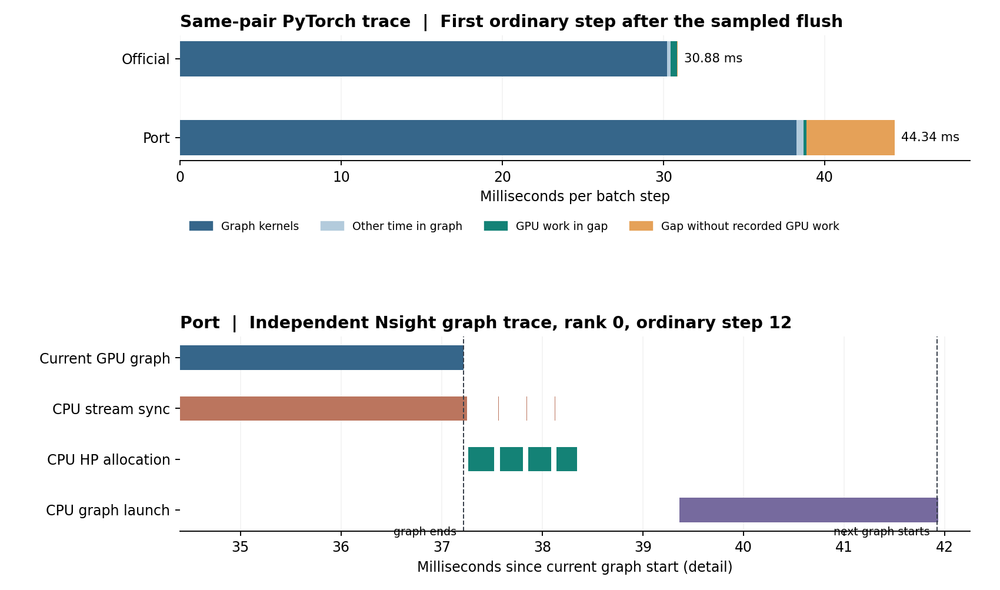

# 官方 LoopVQ 与移植版的 TP2 单步实测

同一套自训 0.5-bit K/V 码本在作者原始服务栈上达到 **132.61 tok/s**，在移植栈上达到 **103.60 tok/s**。移植吞吐低 **21.88%**，每个 bs=4 decode 步平均多 **8.45 ms**。算子采样显示图内最大差额是 RoPE、布局和逐元素运算。CPU/GPU 联合时间线另显示，移植的提前等待和逐请求 HP 分配切断了下一步规划与前一轮 GPU forward 的重叠。

## 同码本纯 decode 吞吐

A10，单机 2×A100-SXM4-80GB，TP2/DP1，Ouro-2.6B-Thinking 完整 R4。2,048 个输入 token，1,024 个新 token，bs=4，HP8+64，greedy、ignore EOS、split 上限 48。相同四份输入、相同模型路径及全部四个 bundle 文件的 SHA256 已核对。吞吐在 GPU 0/1 上依次无 profiler 测量，2 次 32-token 预热，3 次正式请求。从整批第 2 个 token 计时到第 1024 个，分子是 4,088 个 decode token。实际 decode batch 和 graph 标志随请求日志核对。小数均由未舍入数据计算。

| 栈 | 实测 1 | 实测 2 | 实测 3 | 中位数 tok/s | 等效 ms/batch step |
|---|---:|---:|---:|---:|---:|
| 官方 | 132.484 | 132.621 | 132.615 | 132.615 | 30.163 |
| 移植 | 103.597 | 103.661 | 103.467 | 103.597 | 38.611 |

官方服务来自 LoopVQ b5f821d，已核对 python/ 和服务脚本与作者 d5d58c83 一致。移植测试提交 fbe1b00a2 与前次 TP2 测速 cccc70a47 的 python/ 推理代码相同。两栈分别使用自己的 Torch/CUDA 运行时，此试验测量整栈差距。[官方命令及码本哈希](official/manifest.json) · [移植命令及码本哈希](port/manifest.json)

## 一个可闭合的真实 decode 步

在同一对 GPU 6/7 依次使用两栈的 PyTorch CPU+GPU profiler。请求新增输出约 928 token 后开始采样，可见历史约 3K。用 rank-local cudaGraphLaunch 的 correlation ID 关联设备 kernel，保留可验证的相邻完整图。每图验证 772 次 norm，以及 quant、HP、merge、LSE reset 各 192 层。两栈统一选取采样中耗时最长的 K/V encode 之后紧接的第一个普通周期。官方捕获序号 4、correlation 7242；移植序号 5、correlation 5755。序号从 0 开始。

| Rank 0，一个普通步（ms） | 官方 | 移植 |
|---|---:|---:|
| 图内 kernel 活跃时间并集 | 30.196 | 38.245 |
| 图内未被 kernel 覆盖 | 0.227 | 0.428 |
| **图执行跨度** | **30.423** | **38.673** |
| 图间 GPU kernel、拷贝活跃并集 | 0.390 | 0.168 |
| 图间未被记录的 GPU 活动覆盖 | 0.064 | 5.504 |
| **图间隔** | **0.453** | **5.672** |
| **本图首个 kernel 至下图首个 kernel** | **30.876** | **44.345** |

普通步的 rank 1 周期分别为 30.875 / 44.246 ms。紧邻的 flush 步在 rank 0 分别为 31.368 / 45.114 ms，图间 GPU 活跃 0.883 / 0.601 ms。官方普通步也发射两个短 encode kernel，合计约 0.043 ms，重编码步达 0.518 ms；移植普通步未发射 encoder，flush 步两个 encoder 合计 0.361 ms。两个 rank 同时工作，各自的耗时不能相加。节点采样尤其放大移植栈的提交与同步间隔，图内与图外差额不能当作对无 profiler 8.45 ms 的精确百分比分摊。[两栈每一完整周期与两个 rank](step-periods.csv)

### 同一步按算子拆分

单位为 rank 0 每 batch 步的 kernel 累计毫秒。行相加是 kernel 累计值；多个 stream 的重叠按时间区间并集计算后，才得到上表的图内活跃时间。

| 步骤 | 官方 | 移植 |
|---|---:|---:|
| QKV projection | 2.394 | 2.384 |
| RoPE、布局及 attention 周边逐元素操作 | **1.407** | **9.118** |
| KV 写入 | 0.325 | 0.388 |
| 单列的 VQ metadata | — | 0.008 |
| 量化历史 attention 主核 | 9.910 | 9.901 |
| 高精度 attention | 1.507 | 1.484 |
| LSE 清零 | 0.275 | 0.283 |
| HP 与量化结果的合并 | 0.764 | 0.637 |
| O projection | 1.531 | 1.536 |
| TP collective（含图内 AllGather） | 1.981 | 1.317 |
| 四轮 RMSNorm | 2.378 | 2.731 |
| Residual add | 0.735 | 0.732 |
| MLP gate/up projection | 3.747 | 3.759 |
| MLP 激活及逐元素操作 | 0.509 | 1.249 |
| MLP down projection 及其 GEMM 归并 | 2.656 | 2.649 |
| 循环外其他工作 | 0.082 | 0.075 |
| **累计** | **30.201** | **38.250** |

RoPE 周边这一组，官方 587 次 kernel 共 1.407 ms，其中 fused RoPE 192 次共 0.440 ms。移植组有 4,032 次，分别是 1,536 次 BF16 乘法（4.267 ms）、768 次 BF16 转换拷贝（1.455 ms）、768 次拼接拷贝（1.439 ms）、768 次加法（1.255 ms）、192 次索引选择（0.701 ms）。聚合由每层 norm、线性层、attention 和激活的执行位置以及 kernel 符号共同确定。移植的 OuroRotaryEmbedding.forward 显式走 forward_native 以保留 HF 的 BF16 中间舍入，MLP 激活也保留独立乘法。直接换算子需要重新核验数值语义。官方 metadata 的部分小算子在周边组中，破折号表示没有按目标符号单列。

同一个普通步，loop 1–4 的 kernel 合计在官方为 **7.579 / 7.506 / 7.507 / 7.505 ms**，移植为 **9.577 / 9.526 / 9.531 / 9.524 ms**。四轮均出现约 2 ms 增量。[逐步算子及调用次数](step-kernels.csv) · [逐 loop、逐 rank 明细](step-loops.csv)

## 移植版图间隔的直接证据

独立在 GPU 4/5 用 Nsight graph tracing 和具名 Python NVTX 采集。在移植 rank 0 取相邻的普通步 #12 与 flush 步 #13。时间原点是当前 graph 开始。该普通步共 **41.923 ms**，前 **37.217 ms** 为 GPU 图，随后是 **4.706 ms** 图间隔。

| 时点或区间（ms） | 观察 |
|---|---|
| 1.981–2.025 | scheduler 在下一批规划前调用 wait_pending_forward，建立 stream 事件依赖。这个调用约 0.044 ms。 |
| 2.075 | 进入 alloc_for_decode。按请求创建 GPU 请求索引。 |
| 2.120 / 2.133–37.252 | CPU 提交第一个 8 字节 H2D，紧接着执行 cudaStreamSynchronize。GPU 到 37.244 ms 才执行这个拷贝，拷贝本身约 0.0011 ms。同步持续 35.119 ms，大部分与上一图执行重叠。 |
| 37.217 | 当前 GPU graph 结束。 |
| 37.263–38.346 | 依次执行四次 alloc_hp_recent。每请求一次，三次后续 8 字节 H2D 和短同步也能在 trace 中逐一识别。 |
| 38.455 / 38.516 | alloc_for_decode 返回，随后 get_next_batch_to_run 返回。 |
| 38.525 / 39.365 | 进入 run_batch，随后进入下一个 cudaGraphLaunch API。 |
| 41.923 | 下一张 GPU 图开始。API 进入至 GPU 图开始约 2.558 ms，包含提交及 tracing 影响，缺少无探针单变量结果。 |

4.706 ms 图间隔中，GPU kernels/拷贝实际覆盖 **0.165 ms**，其余 **4.541 ms** 在该 rank 上没有记录到 GPU 活动。这 4.541 ms 中，下一次 graph launch API 进入前约 **1.983 ms**、进入后约 **2.558 ms**。后续 flush 步图间隔增至 **5.593 ms**，其中 GPU 活跃 **0.595 ms**，两次 encode 共 **0.359 ms**。所以固定的图间损失在普通步已经出现，周期性的 flush 在此基础上再增加工作。CPU 各函数有嵌套、和 GPU 有重叠；不把 API 驻留、图间残余及 GPU busy 重复计费。[普通步逐事件时间线](ordinary-step-timeline.csv) · [双 rank 所有轻量采样区间](port-light-steps.json)

两栈 Python 范围在同卡对的独立轻量采样中，官方每次选批调用 alloc_hp_recent **一次**（31 次选批、31 次分配），移植每次 **四次**（33 次选批、132 次分配）。两 rank 合并统计的 get_next_batch_to_run 包含等待的单次中位 wall 为官方 **2.304 ms**、移植 **36.919 ms**；process_batch_result 为 **26.228 ms / 0.455 ms**。可见两栈将等待暴露在不同阶段。源码上官方先批量分配、GPU plan，等上一轮 KV 读完成后才 apply。移植在选批前就建立依赖，再逐请求建 GPU 索引。时间线支持这个串行化机制；精确可回收的无 profiler 毫秒数仍要靠同栈消融测量。[CPU 具名范围](scheduler-nvtx.csv)

## 采集边界与复核

正式吞吐完全来自无 profiler 的 GPU 0/1 请求。算子表使用 GPU 6/7 上同类型 PyTorch profiler 的同卡对采集。GPU 4/5 的低开销 Nsight 为另一对独立实验，用于核验 CPU/GPU 相对次序。官方 Nsight node 转换停在 20%，官方 graph 导出的 CUDA runtime 记录也不完整，未拿这些报告推算官方 kernel 或逐步间隔。官方算子和间隔使用成功导出的两份原生 TP trace；官方具名 CPU 范围直接来自成功的 NVTX 记录。移植的节点及图级采集均已成功。输入、输出、完整四轮、码本与数据通路均已核验，GPU 已释放。本次没有修改任一服务栈的推理源码。原始大文件位于 A10 的任务目录。[路径与 SHA256](provenance.json)
